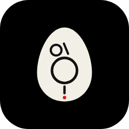
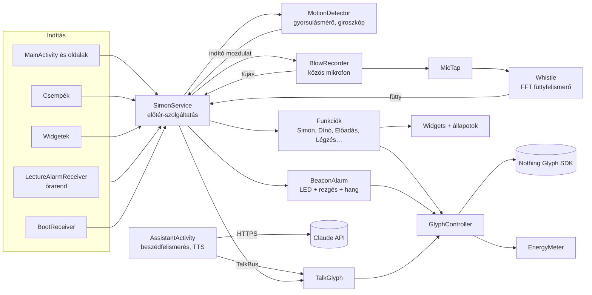

<div align="center">



# Glyph Eggs

**Játékok, eszközök, telefonkereső és hangasszisztens a Nothing Phone (2) hátoldali Glyph LED-jeire**

Glyph Beacon · AI-asszisztens · Stat és kitűzők · Csendzóna · Glyph Stúdió · Morze · Simon Says · Zárfeltörő · Glyph Tojás · Dínófutás · Fújós · Pörgetés · Iránytű · Széf · Vízmérték · Időzítő · Légzés · Előadás
— kártyáról, csempéről, widgetről, mozdulattal, füttyel, hanggal vagy órarend szerint


-000000)


</div>

---

A Glyph Eggs a Nothing Phone (2) hátlapján lévő **33 Glyph LED-et** játékká és hasznos eszközzé teszi. A telefon többnyire kijelzővel lefelé fekszik az asztalon, a LED-ek felfelé néznek – nem kell a képernyőt nézned. Mozdulatokkal (forgatás, kopogás, rázás, döntés, fújás, hangerő-gombok), **füttyel**, **hanggal**, csempékkel, widgetekkel vagy heti órarend szerint indítod. A hivatalos **Nothing Glyph Developer Kit**-re épül: nincs root, nincs trükközés.

<p align="center">
  
</p>

## Tartalom

- [Újdonságok a 12.0-ban](#újdonságok-a-120-ban)
- [Gyors kezdés](#gyors-kezdés)
- [Funkciók egy pillantásra](#funkciók-egy-pillantásra)
- [Kiemelt: Glyph Beacon](#-glyph-beacon--fütyülj-a-telefon-felel) · [Asszisztens](#-asszisztens--kérdezz-hangosan)
- [Játékok](#játékok) – [Simon](#-glyph-simon) · [Zárfeltörő](#-zárfeltörő) · [Glyph Tojás](#-glyph-tojás) · [Dínófutás](#-dínófutás) · [Fújós](#-fújós)
- [Eszközök](#eszközök) – [Pörgetés](#-pörgetés) · [Iránytű](#-iránytű) · [Széf](#-széf) · [Vízmérték](#-vízmérték) · [Időzítő](#-időzítő) · [Légzés](#-légzés) · [Előadás](#-előadás)
- [Stat fül és kitűzők](#-stat-fül-és-kitűzők)
- [Indítás és leállítás](#indítás-és-leállítás)
- [Csempék](#gyorsbeállítás-csempék) · [Widgetek](#widgetek)
- [Az app felülete](#az-app-felülete) · [Értesítések](#értesítések) · [Akku fül](#akku-fül) · [LED-szimuláció](#led-szimuláció)
- [LED-térkép](#led-térkép)
- [Telepítés](#telepítés)
- [Engedélyek és adatvédelem](#engedélyek-és-adatvédelem)
- [Hibaelhárítás](#hibaelhárítás) · [Ismert korlátok](#ismert-korlátok)
- [Fejlesztőknek](#fejlesztőknek)
- [Verziótörténet](#verziótörténet) · [Források és licencek](#források-és-licencek)

---

## Újdonságok a 12.0-ban

| | Újdonság |
|---|---|
| 📡 | **Glyph Beacon**: telefonkereső füttyre. Egy fütty, és a telefon villog, teljes erővel rezeg, és robotos hangot ad. Betanítható a saját füttyödre. Fehér / alumínium oldal, kiemelve a Főoldalon. |
| 🎙️ | **Asszisztens**: beszélgess bármelyik AI-appal (Claude, ChatGPT, Gemini…, a saját fiókoddal, ingyen), és közben a LED-ek „beszélnek”, 9 választható animációval. Gomb az appban és widget. |
| 🧩 | **Négy új widget**: **Vízmérték** (élő fok és buborék), **Pörgetés** (pontokból rakott, pörgő palack), **Homokóra** (Pomodoro), **Asszisztens**. |
| 🔐 | **Széf döntéssel**: a kódot a telefon döntögetésével adod meg, mint a Simonban. A kód 3–8 lépés lehet. |
| 🌬️ | **Légzés** az Egyensúly helyett: vezetett légzőgyakorlat a LED-eken, 5 ritmussal. |
| 🧭 | Átalakított **Indítás és leállítás** oldal: áttekintés funkciónként, külön Indítás / Leállítás fül és egy közös Érzékenység oldal. |
| ✊ | **Kopogás**: érzékenyebb, négy fokozattal, és lassabb tempóban is elfogadja (két koppanás között majdnem 1 mp is lehet). |
| 🦖 | **Dínó könnyebb**: nagyobb és hosszabb ugrás, ritkább akadályok. A leérkezés előtt kicsivel lenyomott ugrást is elfogadja. |
| 💨 | **Fújás**: érzékenyebb, öt fokozattal, alacsonyabb küszöbökkel. |

---

## Gyors kezdés

1. **Telepítsd** az APK-t ([Telepítés](#telepítés)), nyisd meg az appot, és engedélyezd az **értesítéseket**.
2. **Beállítások fül → Háttérfutás**: kapcsold ki az akkuoptimalizálást, különben a rendszer leállíthatja a háttérben.
3. **Főoldal → GLYPH BEACON**: kapcsold be, engedélyezd a mikrofont, és tanítsd be a füttyöd. Így ha elhagyod a telefont, füttyel megtalálod.
4. Kapcsold be a **Mozdulatfigyelés**t. Alapból ezek a mozdulatok indítanak:

   | Mozdulat | Funkció |
   |---|---|
   | jobbra forgatás 2× (fekve) | Glyph Simon |
   | megpörgetés az asztalon | Pörgetés |
   | kopogás 2× (fekve) | Iránytű |
   | rázás-töltés | Előadás |
5. Tedd ki a **csempéket** (Beállítások → Csempék) és a **widgeteket** (Beállítások → Widgetek).
6. **Asszisztens**: tedd ki a widgetet, vagy koppints a Főoldalon a **●** gombra. Megnyílik a választott AI-app (alapból a Claude; a saját fiókoddal, ingyen), a LED-ek pedig a hangjára villognak.
7. Bármelyik kártyán az **„i”** gomb részletes súgót nyit. A **LED-szimuláció** (Beállítások fül) a képernyőn is mutatja, mit csinálnak a LED-ek.

---

## Funkciók egy pillantásra

| | Funkció | Röviden |
|---|---|---|
| 📡 | **Glyph Beacon** | Fütyülj, és a telefon felel: villog (radar, SOS, stroboszkóp), rezeg és szól. Betanítható. |
| 🎙️ | **Asszisztens** | Beszélgetés bármelyik AI-appal (Claude, ChatGPT, Gemini…), a saját fiókoddal; a LED-ek a hangjára villognak. |
| 🏆 | **Stat és kitűzők** | Szint, ábrák, kiértékelés és 30 mozgó, pontmátrixos kitűző; widget is. |
| 🎮 | **Glyph Simon** | Simon Says: a LED-ek mutatnak egy sort, te döntéssel ismétled. 8 kör, szintjelző a felső sávon. |
| 🔓 | **Zárfeltörő** | A felső sávon csúszó fénynél akkor kopogj, amikor a rejtett édes ponton jár (a telefon rezzen). 4 tüske, 3 élet. |
| 🥚 | **Glyph Tojás** | Tamagocsi a hátlapon: kikel, nő, eszik, játszik, alszik. Kopogással és rázással gondozod. |
| 🦖 | **Dínófutás** | A böngésző dínós játéka. Ugrás kopogással, rázással, hangerő- vagy bekapcsoló gombbal. |
| 🌬️ | **Fújós** | Fújj a telefonba, és a fény a töltőport felől felfelé száll. 9 animáció, rekordok, háttérbeli fújásfigyelés. |
| 🍾 | **Pörgetés** | A fény körbefut a gyűrűn, lassul, kattog, és megáll valakinél. Widgeten pörgő palackkal. |
| 🧭 | **Iránytű** | Fekve mutatja az északot: durván a nagy íveken, pontosan egyetlen kis LED-del. |
| 🔐 | **Széf** | A kódot döntögetéssel adod meg. Helyes kódra fényshow, és megnyílik a titkos jegyzet, mappa, app vagy weboldal. |
| 📏 | **Vízmérték** | Fekve, élére vagy töltőportra állítva. Widgeten élő fokkal és buborékkal. |
| ⏳ | **Időzítő** | Pomodoro és más fókusz-időzítők LED-animációkkal, homokóra-widgettel. |
| 🫁 | **Légzés** | Vezetett légzés: belégzésre megtelnek a LED-ek, kilégzésre kiürülnek. 5 ritmus, 1–20 perc. |
| 🎓 | **Előadás** | Egyetemi időzítő: 2 × 45 perc a felső sávon, szünet a függőleges vonalon. Heti órarend szerint magától indul. |

**Közös tulajdonságok**

- Minden funkció indítható kártyáról, **gyorsbeállítás-csempéről**, **widgetről** és **saját indító mozdulattal**. Mindegyikhez beállítható a **leállítási parancs** is (alapból a bekapcsoló gomb).
- **Nothing-stílusú** felület és widgetek: fekete lap, kerek gombok, pontmátrix-betű, piros pötty, ha valami fut. A Glyph Beacon saját, **fehér / alumínium** témát kapott.
- **Rezgéses visszajelzés**: indulás, kattogás, siker, figyelmeztetés.
- **Akkubarát**: csak azt a szenzort és akkora mintavételt járatja, amire épp szükség van. Az **Akku fülön** látod, mennyit fogyaszt.

---

## 📡 Glyph Beacon – fütyülj, a telefon felel

Elhagytad a telefont a lakásban? **Fütyülj egyet**, és a Phone (2) megszólal: a hátlap minden LED-je villog, teljes erővel rezeg, és egy robotos hangeffekt szól. A Főoldal tetején, kiemelt **fehér / alumínium** kártyán találod; koppints rá a saját oldaláért.

**Bekapcsolás**

1. Főoldal → **GLYPH BEACON** kapcsoló, vagy az oldalán a **Figyelés** kapcsoló. Engedélyezd a mikrofont.
2. **Tanítsd be a füttyöd** (ajánlott): *Betanítás* → fütyülj háromszor egy-egy hosszabbat (fél–egy másodperc), úgy, ahogy keresni szoktad. A három pont megtelik, egy csippanás jelzi a sikert. Utána csak a te füttyöd hangmagasságára felel.
3. Próbáld ki a **Próba-riasztás** gombbal.

**Amikor füttyöt hall**

| Mi | Hogyan |
|---|---|
| **LED-ek** | Körbe: **radar** (fénycsík fut végig a töltőporttól a kameráig, kétszer, csóvával) → **SOS** morzejel az összes LED-del → **stroboszkóp** (kamera, gyűrű és alsó rész felváltva, gyorsulva). Ha más funkció futott, azt leállítja. |
| **Rezgés** | Teljes erejű, lüktető (hosszú–rövid–rövid), ismétlődve. Kikapcsolható. |
| **Hang** | Az app **saját, szintetizált** hangja, ébresztő-hangerőn. Alapból maximumra húzza, utána visszaállítja. Három közül választhatsz: **Robot** (bitcrush csipogás, ugráló hangok, felfutó szirénaív), **Szonár** (mély pingelés visszhanggal), **Glyph** (kristálytiszta csengő-hármasok). |
| **Leállítás** | **Bekapcsoló gomb** (a képernyő bekapcsolása), az **app megnyitása**, a Beacon oldal **MEGVAN** gombja, vagy a beállított idő (30 mp – 5 perc) letelte. |

**Hogyan ismeri fel?** A fütty szinte tiszta, egyetlen hangmagasságú hang (kb. 0,5–4 kHz). Az app 32 ms-onként Fourier-transzformációval megnézi, hogy a hangenergia nagy része egyetlen csúcsban van-e. Ha legalább kb. fél másodpercig így marad, és a hangmagasság a betanított tartományba esik, akkor riaszt. Betanítva a te füttyöd hosszának kb. 60%-a elég. Az elektronikus sípolást (mikró, ébresztő, vízforraló) a túl egyenletes hangmagasságáról szűri ki. Riasztás után 6 mp-ig nem figyel, hogy a saját hangjára ne induljon újra.

**Érzékenység**: *Óvatos* · *Normál* · *Érzékeny*. Ha magától is megszólal (madár, sípoló edény), legyen óvatosabb, vagy tanítsd be a füttyöd. Ha nem hallja meg, legyen érzékenyebb.

**Jó tudni**

- A Beacon **saját kapcsolóval** működik, a Mozdulatfigyeléstől függetlenül.
- A mikrofont az Android a háttérben csak akkor engedi, ha **bekapcsoláskor az app látható** volt. Újraindítás után **nyisd meg egyszer az appot**, és újra figyel. A rendszer zöld pöttye jelzi, hogy a mikrofon fut.
- Zsebben, táskában, párna alatt halkabban hallja, ezért közelebbről fütyülj.
- **Ne zavarjanak** módban, ha az ébresztők is tiltva vannak, a hang néma lehet. A villogás és a rezgés akkor is megy.
- Fogyasztás: kb. **18 mA** többlet (≈0,4% akku óránként), az Akku fülön „Glyph Beacon” sorban látszik.
- A mikrofon **csak a hangmagasságot elemzi** – semmit nem rögzít, nem ment és nem küld el.

---

## 🎙️ Asszisztens – kérdezz hangosan

Két módon működik. Az asszisztens oldal tetején választhatsz.

### AI app mód (alap) – bármelyik AI-appal, a saját fiókoddal, ingyenesen

**Nem kell API-kulcs, és nincs extra költség.** A beszélgetés a telefonodon lévő **AI-appban** zajlik, a saját fiókoddal: **Claude, ChatGPT, Gemini, Copilot, Perplexity, Grok, DeepSeek, Le Chat, Meta AI** – vagy bármelyik más telepített app. A Glyph Eggs közben csak „hallgatja”, mikor szól a telefon, és a hátlap LED-jein animálja az AI hangját.

1. Asszisztens oldal → **AI-APP → Váltás**: válaszd ki az appot. A telepített ismert AI-appok elöl vannak, a *Más app a telefonról…* alatt bármelyik app választható. Alapból a Claude.
2. Főoldal → **ASSZISZTENS** kártya **●** gombja, vagy az **Asszisztens widget**, vagy az oldalon a **Beszélgetés: …** gomb.
3. Bekapcsol a LED-követés, és megnyílik a választott app. Ha nincs telepítve, a Play Áruház nyílik meg.
4. Az appban indítsd a **hangos beszélgetést** (Claude: hullám ikon; ChatGPT: hang mód; Gemini: Live).
5. Amíg **az AI beszél**, a hátlap a választott **beszéd-animációval** villog a hangjára. Amíg **te beszélsz**, a kamera pislog.
6. **5 perc csend** után magától leáll, de az oldalon vagy az értesítésben is leállíthatod.

Ha az asszisztenst nem appként nyitod meg, hanem például a bekapcsoló gombbal vagy „Hey Google”-lel hívod elő (Gemini), használd a **Csak LED-követés** gombot: ez csak a fényeket kapcsolja be.

Hogyan tudja, mikor beszél az AI? Az Android hangkimenetének erejét méri (`Visualizer`), így a LED-ek a valódi hanghoz igazodnak, szótagra pontosan. Ha a rendszer ezt nem engedi, akkor a lejátszások listájából tudja, hogy épp szól valami, és ilyenkor beszédszerű ütemre villog. A mikrofon-engedélyt ehhez a méréshez kéri; semmit nem rögzít és nem küld el. Közben **bármilyen** hangra reagál (zenére is), ezért csak addig fut, amíg be van kapcsolva.

> Az AI-fiókodba a Glyph Eggs közvetlenül nem tud bejelentkezni. Erre egyik szolgáltatónál sincs hivatalos lehetőség, és a feltételeik általában nem engedik, hogy az előfizetést más appok használják. Ezért a beszélgetés az AI saját appjában marad, a Glyph Eggs csak a fényeket adja hozzá.

### Saját API-kulcs mód (haladó, fizetős)

Ebben a módban minden az appon belül történik: a telefon beszédfelismerője, Claude válasza és a felolvasás is. A LED-ek itt szótagra pontosan követik a beszédet, és a beszélgetés is látszik.

**Beállítás (API mód)**

1. Szerezz egy **Claude API-kulcsot** a [console.anthropic.com](https://console.anthropic.com) oldalon. Az API külön fizetős szolgáltatás, nem része a Claude-előfizetésnek.
2. Asszisztens oldal → **fogaskerék** → illeszd be a kulcsot → **Mentés**.
3. Ha a telefon nem beszél magyarul: *Beállítások → Rendszer → Nyelvek → Szövegfelolvasás* → tölts le magyar hangot (Google Szövegfelolvasó).

**Menete**

| Állapot | Képernyő | LED-ek |
|---|---|---|
| **Hallgatlak…** | élőben látszik, amit mondasz | a függőleges vonal a hangerődet mutatja, a kamera pislog |
| **Gondolkodom…** | – | három pontos csóva fut körbe a gyűrűn |
| **Válaszolok** | a válasz szövege | a választott **beszéd-animáció** szótagra pontosan |

A felolvasó szavanként jelez, az app pedig minden szót szótagokra bont (a magánhangzókat számolja). Minden szótag egy villanás, a hangsúlyos első szótag a legerősebb. Ha a felolvasó nem jelzi a szavakat, egyenletes szótag-ütemre vált.

**Beszéd-animációk** (Asszisztens → fogaskerék; koppintásra a telefon mond egy mondatot, és megmutatja):

| Animáció | Mit csinál |
|---|---|
| **Egyszerre** | Minden szótagra az összes LED egyszerre felvillan – mint egy hangszóró membránja |
| **Felváltva** | Kamera, gyűrű és alsó vonal felváltva, szavanként váltva |
| **Hangerő-hullám** | Alulról felfelé töltődik a hangod erejével, mint egy VU-mérő |
| **Hangszínkép** | A 16 pontos felső sáv ugrál, mint egy hangszínkép-kijelző |
| **Száj** | A felső sáv középről kifelé nyílik, az alsó ívek csukódnak – mint egy száj |
| **Körbe** | Fénycsóva fut körbe a gyűrűn, minden szóra lendületet kap |
| **Visszhang** | Minden szó a kamerától indul, és hullámként fut le a töltőportig |
| **Szikrák** | Véletlen LED-ek szikráznak, a hangsúlytól függő sűrűséggel |
| **Kombinált** (alap) | A kamera villan a szavakra, a sáv a hangerőt mutatja, a gyűrű körbejár – minden egyszerre |

**További beállítások**: modell (**Haiku** – gyors, ideális hangos beszélgetéshez; **Sonnet** – okosabb, kicsit lassabb) · beszédtempó (4 fokozat) · **beszélgetés-memória** (az előző kérdésekre is épít; az *Új beszélgetés* törli) · LED-animáció be/ki.

- Claude rövid, beszélt nyelvű, felolvasásra szánt válaszokat ad: nincs markdown, felsorolás vagy emoji, és ismeri a pontos dátumot és időt.
- A hangod **nem** megy az Anthropichoz. A telefon beszédfelismerője alakítja szöveggé (ez általában a Google szolgáltatása), és csak a kérdés **szövege** megy a Claude API-hoz.
- Amíg hallgat, a Beacon és a fújásfigyelés mikrofonja szünetel, utána magától visszakapcsol.
- Ha egy másik funkció fut, a LED-ek nem animálnak (a képernyőn akkor is látszik minden).

---

## Játékok

### 🎮 Glyph Simon

1. Tedd le a telefont kijelzővel lefelé, a töltőport feléd nézzen, és indítsd (alapból: **jobbra forgatás 2×**). A LED-ek háromszor körbefutnak.
2. A telefon lejátszik egy sort. **Döntsd** arra, amerre a fény villant (fel = kamera felé, le = töltőport felé, balra, jobbra), majd engedd vissza középre.
3. Minden körben **az egész sort** végig kell dönteni, a végén egy új iránnyal.
4. Körönként **2 LED** gyullad a felső sávon. 8 kör után betelik: kb. 8 mp-ig minden villog és rezeg. 🎉
5. Rossz iránynál vagy 7 mp tétlenség után vége; az elért szint még 3 mp-ig látszik.

### 🔓 Zárfeltörő

1. Indítsd, és tedd le kijelzővel lefelé.
2. A **felső sávon** egy fénypont csúszik ide-oda. Valahol a közepe táján van egy **rejtett édes pont**: amikor a fény odaér, a telefon **egy kicsit rezzen**.
3. Erre **kopogj** a telefonon. A reakcióidőt figyelembe veszi (a rezzenés után kb. 0,3 mp-ig még talál).
4. **Közel jártál** (1–2 LED): a fény és a cél közti LED-ek felvillannak, életet nem veszítesz. **Nagyon mellé**: elvész egy élet (3 élet: a kamera két fele és a ferde csík).
5. **Talált**: kattan a zár. A kinyitott tüskéket a függőleges vonal mutatja, és tüskénként gyorsul a fény. **4 tüske** = nyitva!

### 🥚 Glyph Tojás

Tamagocsi, ami a Glyph LED-eken él. A kártyán megnyílik a saját oldala élő LED-képpel, állapotjelzőkkel és gondozó gombokkal.

- **Élete:** tojás (3 gondoskodás vagy 20 perc után kikel) → Kicsi → 1 nap után Kamasz → 3 nap után Felnőtt. Az idő akkor is telik, ha nem nézed: éhes lesz, unatkozik, elfárad, kakil. Ha sokáig elhanyagolod, beteg lesz, és végül elköltözik.
- **A hátlapon:** kamera = szemek (pislog), ferde csík = antenna, felső sáv = a teste (boldogan ugrál), függőleges vonal = könnycsepp, alsó ív = betegség, pont = kaki.

**Gondozás a LED-eken** (tedd le kijelzővel lefelé):

| Mozdulat | Művelet |
|---|---|
| 1 kopogás | Simogatás (szívecske, dorombolás) |
| 2 kopogás | Etetés (a falat felmegy a vonalon) |
| 3 kopogás | Játék (labdakergetés a gyűrűn) |
| 4 kopogás | Altatás / ébresztés |
| rázás | Fürdetés |
| döntés | arra néz, amerre döntöd |

Gyógyítani az app oldaláról lehet. Óránként ránéz, és ha valami kell neki, **értesítést** küld (kikapcsolható).

### 🦖 Dínófutás

1. Indítsd. A **felső sáv** a pálya: a dínó a bal végén áll, jobbról jönnek az akadályok.
2. **Kaktusz** (égő fény): **ugorj**. Ugrás közben a dínó „fent” van: a ferde csík és a kamera teteje ég.
3. **Madár** (villogó fény, 8 pont után): **ne ugorj**, átrepül fölötted.
4. Egyre gyorsabb. 10 pontonként egy LED gyullad a függőleges vonalon, 100 pontonként minden felvillan. Ütközéskor a pontszám látszik, a rekord a kártyán.

**12.0: könnyebb.** Az ugrás **5 lépésig** tart (eddig rövidebb volt), az akadályok között legalább 7 lépés a hely. Ha leérkezés előtt legfeljebb 0,2 mp-cel ugrasz, a dínó földet érve azonnal újra felugrik (ugrás-puffer), így a gyors egymásutánokat is elkapod.

**Mivel ugorjon?** (Játékok fül → *Dínófutás beállítása*; több is bekapcsolható)

| Bemenet | Megjegyzés |
|---|---|
| **Kopogás** (alap) | Fekve; az érzékenység állítható |
| **Rázás** | Egy erős rántás – kézben is játszható |
| **Hangerő fel / le gomb** | Kísérleti: a játék alatt egy médiamunkamenet kapja a gombokat (a hangerő nem változik); nem minden rendszer engedi |
| **Bekapcsoló gomb** | Minden nyomás ugrás; ilyenkor a bekapcsoló gombos leállítás a Dínónál nem működik |

### 🌬️ Fújós

Fújj a telefon aljába (a töltőport mellett van a mikrofon), és a hátlapon a fény **a töltőport felől felfelé száll**, mintha belefújnál. A Fújós oldalon élőben látod a hátlap képét és a fújás erejét.

| Animáció | Mi történik | Cél |
|---|---|---|
| **Labda** | Egy LED – fújd fel a kamera tetejéig; ha abbahagyod, visszaesik | felérni (idő) |
| **Rakéta** | Csak erős fújásra indul, csóvát húz; fent tűzijáték | felérni (idő) |
| **Hőmérő** | Alulról telik, amíg fújsz, magától apad | megtölteni (idő) |
| **Szülinapi gyertyák** | Minden LED pislákoló láng; ha vársz, újra meggyulladnak | elfújni mindet (idő) |
| **Lufi** | Felfújod, a fény a gyűrűre terjed – túl sokáig fújva: DURR! | nem kidurrantani |
| **Szélkerék** | Három fénylapát forog, a fújás erejével gyorsul | 3 mp csúcssebesség |
| **Buborékok** | Fújásra buborékok szállnak fel | játék |
| **Pitypang** | Minden LED egy mag; fújásra leválnak és felszállnak | lefújni mindet (idő) |
| **Tábortűz** | Parázsból lobogó láng, gyorsan visszaesik | elérni a kamerát (idő) |

- **Érzékenység: öt fokozat** (Alacsony · Közepes · Magas · Nagyon magas · Maxi), a 12.0-tól alacsonyabb küszöbökkel: halkabb fújásra is reagál. A beszédet és a koppanásokat kiszűri.
- **Rekordok** a célba érős animációknál; a Lufinál azt számolja, hányszor durrant ki.
- **Fújásfigyelés** (Játékok fül, vagy a Fújós oldalon a *Mindig figyel*): a **Mozdulatfigyeléssel együtt** működik. Ha mindkettő be van kapcsolva, **bármikor megfújhatod a telefont**: az app megnyitása nélkül is indul a játék, és 8 mp csend után leáll. Becsült fogyasztás kb. 15 mA. Újraindítás után az app első megnyitásakor kapcsol vissza.
- Fújásfigyelés nélkül a játék addig fut, amíg a Fújós oldal nyitva van (a képernyő közben nem alszik el).

---

## Eszközök

### 🍾 Pörgetés

1. Indítsd (alapból: **pörgesd meg a telefont** az asztalon), és tedd le kijelzővel lefelé az asztal közepére.
2. A fénypont 4–6 kört fut a gyűrűn, 5–7 mp alatt lelassul, a végén kattogó rezgéssel kúszik.
3. Megáll: a kiválasztott hely 5-ször villog, és 4 mp-ig égve marad. **Akire mutat, az a kiválasztott.** Minden irány azonos eséllyel jön ki.

**Pörgetés widget**: koppints rá, és egy **pontokból rakott palack** pörög a widgeten (piros kupakkal), miközben a hátlapon is pörög a fény – lerakás nélkül, azonnal. Megálláskor a gyűrű célpontja pirosan kivilágosodik: **ITT ÁLLT MEG**.

### 🧭 Iránytű

1. Indítsd (alapból: **kopogás 2×** fekve), és tedd le kijelzővel lefelé egy sík felületre.
2. **Durva irány:** ha az észak a nagy ívek felé esik, az az ív ég.
3. **Pontos irány:** forgasd, amíg az észak a felső sávra kerül. Kis kattanás jelzi, és onnan **egyetlen kis LED** mutatja pontosan az északot.
4. Felemelés után még 5 mp-ig vár; ha visszateszed, folytatja.

### 🔐 Széf

**12.0: a kódot döntögetéssel adod meg**, mint a Simonban – kézben is működik.

1. **Széf beállítása** (Eszközök fül):
   - **Kód**: 3–8 lépés (állítható). Minden mező egy irány; koppintásra vált (↑ előre, → jobbra, ↓ hátra, ← balra), és a mező a hátlap megfelelő LED-jeit mutatja.
   - **Mi nyíljon meg**: titkos jegyzetek, egy mappa, egy app, egy weboldal vagy semmi.
2. Indítsd: a négy irány egyszer körbefut, aztán tartsd **vízszintesen**.
3. **Döntsd** a telefont a kód első irányába. Felvillan az irány LED-je, a felső sávon nő a haladás. Engedd vissza középre, jöhet a következő (lépésenként legfeljebb 15 mp).
4. Az utolsó lépés után: **jó kód** → kb. 5 mp fényshow, rezgés, és megnyílik a cél. **Rossz kód** → lassú villogás, hosszú rezgés. A rossz lépést nem árulja el menet közben.

A titkos jegyzetek csak a kinyitás után 2 percig nyithatók meg, egyszer, és róluk képernyőkép sem készülhet. Azonnali megnyitáshoz a „megjelenés más appok felett” engedély kell, különben értesítésből nyílik.

### 📏 Vízmérték

A helyzetet magától felismeri:

| Helyzet | Mit mér | Nem vízszintes | Vízszintes |
|---|---|---|---|
| **Fekve** | bal–jobb és előre–hátra | a magasabb oldal / vég ég | a két oldal **és** a két vég egyszerre ég |
| **Hosszú élére állítva** | a telefon hossza mentén | a magasabb vég ég | **mindkét vég** ég |
| **Töltőporton állva** | a rövid oldal mentén | a magasabb oldal íve ég | **mindkét oldal** ég |

A felső sáv mutatja az eltérést (LED-enként 0,5°); 0,5°-on belül **minden felvillan** és rezeg. Kalibrálás helyzetenként: 2 kopogás = nulla, 3 = törlés. 5 perc mozdulatlanság után kikapcsol.

**Vízmérték widget**: koppintásra indul a hátlapi vízmérték, és a widget **élőben** mutatja a **fokot** (pontmátrixos számmal) és egy **buborékot**. Fekve pontokból rakott kör célkereszttel, élére állítva egy pontsor. Vízszintesnél a buborék piros, a kör kivilágosodik, és a felirat: **VÍZSZINTES**. Újra koppintva leáll.

### ⏳ Időzítő

Fókusz-időzítő a LED-eken. **Időzítő beállítása** (Eszközök fül), élő előnézettel.

| Fajta | Felépítés |
|---|---|
| Pomodoro | 25 / 5 perc × 4, a végén 15 perc |
| Rövid Pomodoro | 15 / 3 × 4, a végén 10 perc |
| Mély fókusz | 50 / 10 × 3, a végén 20 perc |
| 52 / 17 | 52 perc munka / 17 perc szünet × 3 |
| Sprint | 10 / 2 × 5 |
| Egyszeri | 1–90 perc |
| Homokóra | rövid (pl. 1–5 perc) |

**Animációk:** Homokóra (a homok felül fogy, a szemek a töltőportig hullanak, alul gyűlnek) · Fogyó sáv · Óramutató · Lélegző · Eső · Csak a vége. Szünetben a gyűrű lélegzik. **Kopogással:** 1 = hátralévő idő 3 mp-re, 2 = szünet / folytatás, 3 = következő szakasz.

**Homokóra widget**: pontmátrixos homokóra, felül a nyak felől fogy a homok, alul gyűlik, a nyakban piros szem hull. Mellette a hátralévő percek és a szakasz („POMODORO · 2/4”, szünetben kék homok, megállítva „SZÜNETEL”). Koppintásra indul / leáll.

### 🫁 Légzés

Az Egyensúly helyére került: **vezetett légzőgyakorlat** a hátlapon. Fekve, kézben, párnán is követhető, nem kell letenni.

- **Belégzés**: a LED-ek alulról (töltőport) felfelé **megtelnek**, a kamera feléig.
- **Bent tartás**: a kamera lassan pislog.
- **Kilégzés**: felülről lefelé **kiürülnek**.
- **Kint tartás**: csak az alsó pont ég.
- Minden fázisváltásnál finom rezgés jelez, így csukott szemmel is követhető.

| Ritmus | Felépítés | Mire jó |
|---|---|---|
| **4-7-8** | 4 be · 7 bent · 8 ki | elalváshoz |
| **Doboz-légzés** | 4 · 4 · 4 · 4 | fókusz, stressz ellen |
| **Koherens** | 5,5 be · 5,5 ki | egyenletes nyugalom |
| **Nyugtató 4-6** | 4 be · 6 ki | gyors megnyugvás |
| **Ébresztő 4-4** | 4 be · 4 ki | frissít, ha álmos vagy |

Hossz: **1 · 3 · 5 · 10 · 15 · 20 perc** (Eszközök → *Légzés beállítása*).

### 🌙 Csendzóna (telefon-böjt)

Tedd le a telefont kijelzővel lefelé, és **amíg hozzá sem érsz, a hátlapon nő a fény**: alulról, a töltőport felől felfelé, LED-enként. A cél idejére mind a 33 LED ég. Ha felveszed vagy megfordítod, a sorozat megszakad, és az eredmény bekerül a statisztikába.

1. Indítsd (kártya, csempe, widget, mozdulat, Csendzóna oldal), és 20 mp-en belül tedd le kijelzővel lefelé.
2. Amíg nyugton marad, gyűlnek a percek. A cél elérésekor ünnepi villogás és rezgés jön, utána tovább számol.
3. Felvételkor vagy megfordításkor leáll, és megmutatja, meddig bírtad. A bekapcsoló gomb is leállítja, a megszerzett percek akkor is megmaradnak.

**Csendzóna beállítása** (Eszközök fül): **cél** 15 / 30 / 60 / 90 perc, 2 / 3 óra; **mutatás**: *Percenként felvillan* (sötét, csak percenként egy pillanatra mutatja a haladást – akkubarát), *Mindig látszik*, *Teljes sötét* (csak a végén derül ki). Az oldal tetején a rekordok: leghosszabb csend, teljesített célok, összes idő.

**Statisztika és kitűzők**: a Stat fülön külön sor: leghosszabb csend, teljesített és megszakított alkalmak, 14 napos diagram. Öt saját kitűzője van:

| Kitűző | Feltétel |
|---|---|
| Első csend | 10 perc egyhuzamban |
| Lekapcsolva | 60 perc egyhuzamban |
| Fegyelem | 10 teljesített cél |
| Remete | 3 óra egyhuzamban |
| Csendmester | 10 óra összesen |

🍃 **Mind az 5 Csendzóna-kitűzővel feloldódik a Zen téma** a titkos menüben – lásd lent.

### 📡 Morze-gyakorló

A hátlap **felső sávján (C1, 16 LED) balra fut egy rövid, hasznos szó morzekódja**: a **pont 1 LED**, a **vonás 3 LED**. A jelek között 1, a betűk között 3 sötét LED van. A függőleges vonal annyi LED-del ég, ahány betűs a szó, és új szó előtt az alsó pont felvillan.

1. Indítsd (kártya, csempe, **widget**, mozdulat, hangerő-kombináció). A kód **először egyszer fut végig**.
2. Utána **magától megjelenik a billentyűzet** a Morze oldalon (ha nem volt nyitva, megnyílik), és rögtön írhatod a megfejtést.
3. Ha **8 mp-en belül** nincs meg, a kód **folyamatosan ismétlődik**, amíg el nem találod, vagy le nem állítod. *Megoldás* gomb: feladod, és megmutatja a szót.
4. Helyes válasznál fényshow és rezgés jön, aztán a következő szó.

| Beállítás | Választható |
|---|---|
| Nehézség | **Könnyű** (SOS, OK, NEM, MA…), **Közepes** (IGEN, SZIA, HAZA, MOST…), **Nehéz** (RADIO, HOTEL, TELEFON, MAYDAY…), **Vegyes** |
| Tempó | Lassú · Közepes · Gyors |
| Morze-ABC | beépített táblázat a tanuláshoz |

Kézben használod, ezért a felemelés és a megfordítás nem állítja le, és alapból a bekapcsoló gomb sem.

**Statisztika** (a Morze oldalon és a Stat fülön): megfejtett szavak, pontosság, legjobb hibátlan sorozat, átlagos megfejtési idő, 8 mp-en belüli megfejtések, összes betű, rossz tippek és feladások.

**Kitűzők:**

| Kitűző | Feltétel |
|---|---|
| Első jel | az első megfejtett szó |
| Gyorsfülű | 10 szó az első 8 mp-en belül |
| Rádiós | 25 megfejtett szó |
| Hibátlan adás | 10 szó egymás után hiba nélkül |
| Távírász | 100 megfejtett szó |

📡 **Mind az 5 Morze-kitűzővel feloldódik a Távíró téma** a titkos menüben: borostyán képcső, a háttérben halvány pont-vonás sorok (valódi morzeszavak), képcső-csíkozás.

**Morze widget** (4×1): koppintásra indul a gyakorlás, és megnyílik a megfejtő oldal. Futás közben a widget a **mostani szó kódját** mutatja pont-vonásban (a szót nem), így a kezdőképernyőről is megfejtheted. Alatta a megfejtések száma, a legjobb sorozat és a pontosság.

### 🎨 Glyph Stúdió

Saját LED-animációk rajzolása, képkockánként.

- **Rajzolás:** a hátlap képén koppints egy fényre a be- vagy kikapcsolásához, vagy húzd végig az ujjad (festés / radír). Gyors gombok: *Mind be*, *Mind ki*, *Fordít*.
- **Képkockák:** alul szalag a kis előnézetekkel; *+ Új*, *Másolat*, áthelyezés (◀ ▶), törlés (✕). Minden képkockának saját hossza van (− / +), és van *Mindre ugyanennyi*, *Gyorsabb ×½*, *Lassabb ×2*.
- **Ismétlés:** 1×, 2×, 3×, 5× vagy végtelen (∞).
- **Lejátszás:** előnézet a képernyőn, és *✦ Lejátszás a hátlapon*.
- **Sablonok** kiindulásnak: Körbefutó, Szívverés, Töltés, Villogó, Pislogó szem, Eső, Ping-pong, vagy üres lappal.
- Több animáció is menthető; az egyik a **★ kedvenc**. A Glyph Stúdió funkció (kártya, csempe, widget, **mozdulat** vagy **hangerő-kombináció**) ezt játssza le, így bármelyik indító mozdulathoz saját animációt köthetsz.
- Kitűző jár érte: **Fényrendező** – az első saját animáció.

### 🎓 Előadás

Egyetemi előadáshoz: a LED-ekről leolvasod, mennyi van még hátra. Alapból **2 × 45 perc**, köztük **15 perc szünet**.

1. **Indítás (feltöltés).** Alapból a **Rázás-töltés** mozdulattal: rázd a telefont, és a LED-ek **alulról, a töltőport felől** gyulladnak ki, minden rázással feljebb. Ha mind a 33 ég, indul. (Kártyáról is indítható; widgetről és órarendből azonnal, töltés nélkül.)
2. **Előadás.** A **felső sáv** (16 LED) mutatja a hátralévő időt (2 × 45 percnél LED-enként ≈ 5,6 perc; a sáv fele = az első 45 perc). Egy rész végén rezgés és villogás; alapból 5 perccel előtte is jelez.
3. **Szünet.** **Rázd meg kétszer**: indul a szünet, amit a **függőleges vonal** (a töltőport felőli 8 LED) mutat. Közben az előadás ideje áll; a szünet végén ott folytatódik, ahol abbamaradt.
4. **Vége.** Minden LED villog, rezeg, aztán minden kikapcsol.

**Heti órarend** (Előadás beállítása → *Heti órarend*): vegyél fel órákat – **tárgy neve, nap, kezdés, hossz**. A megadott időben az előadás **magától indul**, azonnal, a bejegyzés hosszával; az értesítésben a tárgy neve is látszik. Egy kapcsolóval szünidőre kikapcsolható, alatta látszik a következő óra. Pontos ébresztővel működik, újraindítás és óraátállítás után is újraütemez.

**Ami még állítható** (Eszközök → *Előadás beállítása*, élő előnézettel):

| Beállítás | Választható | Alap |
|---|---|---|
| Részek száma / hossza / szünet hossza | 1–4 rész · 5–180 perc · 1–60 perc | 2 · 45 · 15 |
| Animáció | Fogyó sáv · Nyugodt sáv · Részenként · Homokóra · Szívverés · Futófény · Óramutató · Takarékos | Fogyó sáv |
| Jelzés a rész vége előtt | 5 perccel előtte rezgés + kettős villanás | be |
| Indítás módja | Rázás · Kopogás · Azonnal | Rázás |
| Widgetről azonnal | rázás és lerakás nélkül indul | be |
| Szünet indítása | Rázás kétszer · Kopogás 3× · Nincs | Rázás kétszer |
| Több szünet / Folytatás előbb / Automatikus szünet | be / ki | ki / be / ki |

Alapból a bekapcsoló gomb **nem** állítja le (hogy megnézhesd az órát); a kártya, csempe, widget vagy értesítés igen.

---

## 🏆 Stat fül és kitűzők

<p align="center"></p>

A **Stat** fülön minden látszik, amit a Glyph Eggs-szel csináltál. Minden adat a telefonon marad.

| Rész | Mit mutat |
|---|---|
| **Játékos-szint** | XP-ből számolt szint és rang (Újonc → Felfedező → Haladó → Veterán → Fénymester → Glyph-legenda), pontsoros haladással. XP: indításonként 10, percenként 1, és a kitűzők fokozata szerint 50–500. |
| **Számok** | Összes indítás, idő a fényben, napos sorozat, kitűzők száma |
| **Az elmúlt 14 nap** | Pontoszlopos diagram naponként (ma piros), és a heti változás az előző héthez képest |
| **Mikor játszol** | 24 órás pontsor: minél többet játszol egy órában, annál fényesebb; a csúcs piros |
| **Kiértékelés** | Automatikus, vicces, de pontos megállapítások: kedvenc játék, mivel töltöd a legtöbb időt, éjjeli bagoly vagy korán kelő, rekordnap, Simon- és Dínó-rekord, leghosszabb sorozat, mit nem próbáltál még, melyik kitűző a legközelebbi |
| **Mivel mennyit** | Funkciónként pontsor az idő arányával (az első piros) |
| **Kitűzők** | Mind a 41 kitűző, mozgó pontmátrixos érmekkel; a még meg nem szerzetteknél a gyűrű a haladást mutatja. Koppints rá a részletekért |
| **Játékonként** | Indítások, idő, utolsó játék, rekordok (Simon-szint, zár-tüskék, Dínó-rekord és átlag, kinyitott széf, kidurrantott lufi, a Tojás állapota…) és 14 napos mini-diagram |

**Kitűzők.** Négy fokozat: **bronz**, **ezüst**, **arany** és **legendás** (piros, lüktető glóriával). Mindegyik egy 9×9 pontos ikon egy pontgyűrűben; a gyűrűn csillanás fut körbe, az ikonon átsöpör a fény.

| Kitűzők | Feltétel |
|---|---|
| Első fény · Rendszeres · Glyph-függő · **Fénylegenda** | 1 / 25 / 100 / 500 indítás |
| Egy óra fényben · Tíz óra ragyogás | 1 / 10 óra összesen |
| Visszatérő · Heti rituálé | 3 / 7 egymást követő nap |
| Éjjeli bagoly · Korán kelő | játék 0–4 / 5–7 óra között |
| Emlékező · Simon mester | Simon 5. szint / mind a 8 kör |
| Betörő | Zárfeltörő: mind a 4 tüske |
| Futó · Meteor elől | Dínó: 50 / 150 pont |
| Durr! · Szélgép | kidurrantott lufi / 20 Fújós játék |
| Kikelt! · Felnevelő | a Tojás kikel / felnő |
| Szerencsekerék · Kódtörő · Tökéletes vízszint | 25 pörgetés / kinyitott széf / 10× pont vízszintes |
| Zen · Fókuszgép · Szorgalmas hallgató | 60 perc légzés / 5 óra időzítő / 10 előadás |
| Megvagy! · Beszélgető | füttyel megtalált telefon / 10 AI-beszélgetés |
| Mindenevő · Felfedező · **Gyűjtő** | minden játék / minden funkció / 20 kitűző |

Új kitűzőnél értesítés jön (kikapcsolható: Beállítások → Értesítések → *Új kitűző*).

**Kitűzők widget** (4×2): balra a kiemelt kitűző **mozog**: a kezdőképernyő hat képkockát pörget, így a csillanás körbefut. Koppintásra a következő megszerzett kitűzőre vált, amíg pedig nincs egy sem, a legközelebbi célt mutatja szürkén, haladással. Jobbra a neve, a fokozata, a szinted, a darabszám és az 5 legutóbbi kitűző; erre koppintva a Stat fül nyílik meg.

### 🔒 Titkos menü: neon témák

Az app elején nem látszik. Amikor megvan a **2. kitűződ**, értesítés jön, és megjelenik a **TITKOS MENÜ** a Stat fül tetején és a Beállítások fülön, az első neon témával. A többi téma további kitűzőkkel, **sorban** oldódik fel:

| Téma | Hangulat | Kitűző kell |
|---|---|---|
| **Night City** | cyberpunk, magenta × cián, képcső-csíkozás | 2 |
| **Synthwave** | 80-as évek naplemente, neonrács a horizonton | 4 |
| **Toxic** | savzöld, sárga-fekete figyelmeztető csík | 6 |
| **Grid Runner** | Tron-kék lézerrács, narancs kiemelés | 8 |
| **Ultraviolet** | Nothing-piros × UV-lila derengés | 11 |
| **Vaporwave** | pasztell neon, menta × rózsa | 14 |
| **Arcade RGB** | szivárvány, minden kártya más színű | 18 |
| **Zen** 🍃 | minimalista: tusfekete, papírszín és moha, halvány ensō-kör és gereblyézett homok, semmi izzás | **az 5 Csendzóna-kitűző** |
| **Távíró** 📡 | borostyán képcső, pont-vonás minta | **az 5 Morze-kitűző** |
| **C0RRUPTED** 🏴 | glitch: sérült textúrák, szakadó képernyő, RGB-csúszás | **mind** (az összes kitűző) |

A téma az egész appra érvényes: díszített háttér, neon szegélyű kártyák, izzó pontmátrixos címek és **színes hátlap-kép**. A widgetek maradnak Nothing-feketék. Bármikor visszaállítható az alap *Nothing* téma.

<p align="center"></p>

**C0RRUPTED – az utolsó, a legnehezebb.** Csak az kapja meg, aki **az összes (41) kitűzőt** összegyűjtötte, a Fénylegendát (500 indítás) és a Gyűjtőt is. A téma „sérült”: a háttéren pixelblokkok, zaj és színes szakadásvonalak vannak, minden felirat piros RGB-szellemképet kap. Időnként, véletlenszerűen pár képkockányi kitörés jön, ilyenkor a kártyák megrándulnak és elcsúsznak, a képernyőn cián és piros szakadások futnak át. Utána minden visszaáll, mintha mi sem történt volna.

<p align="center"> &nbsp;  &nbsp; </p>

**Zen** – a Csendzóna jutalma. Nem a kitűzők számán múlik, hanem azon, hogy mind az **5 Csendzóna-kitűző** megvan-e. Csendes, minimalista téma: sötét tus-háttér, papírszínű betűk, mohazöld kiemelés, halvány ecsetvonásos ensō-kör és gereblyézett homok hullámai az alján, izzás és neon nélkül.

<details>
<summary><b>Spoiler: a titkos gomb</b></summary>

A Főoldalon **nyomd és tartsd 10 másodpercig a hátlap képét** (az élő Glyph-képet). Az első 2 mp-ben semmi nem történik, utána a kép lassan feltöltődik, és másodpercenként egy kis kattanás jelez. A végén győzelmi rezgés jön, **minden neon téma feloldódik** (a C0RRUPTED is), és megnyílik a titkos menü. Ha közben elengeded, nem történik semmi.
</details>

---

## Indítás és leállítás

**Beállítások fül → Indítás és leállítás.** A 12.0-ban átalakítottuk, hogy könnyebb legyen eligazodni:

1. **Áttekintés** – felül a Mozdulatfigyelés állapota és hogy hány funkciónak van mozdulata. Alatta **minden funkció egy sorban**: ikon, *Indul: …* és *Leáll: …*, BE jelvény, ha van indító mozdulata. Koppints egy sorra.
2. **Egy funkció oldala** – felül összefoglaló kártya, alatta **Indítás | Leállítás** váltó.
   - *Indítás*: a mozdulatok **csoportosítva** (Forgatás az asztalon · Kopogás és rázás · Gombok). Csak a kiválasztottnál látszik a leírás, és piros felirat jelzi, ha egy mozdulat már máshoz tartozik.
   - *Leállítás*: kapcsolók egy kártyán; amelyik nem választható, megmondja, miért.
   - Alul **Másik funkció** gyorsgombok, így nem kell visszalépni.
3. **Érzékenység** – egy helyen a **kopogás** (4 fokozat), a **rázás** (4 fokozat) és a **Rázás-töltés rázásszáma** (3–40).

A funkciók saját oldaláról (Fújós, Dínó, Széf, Előadás, súgó) egyenesen az adott funkció beállítása nyílik.

### Indító mozdulatok

| Mozdulat | Hogyan | Alapból |
|---|---|---|
| Jobbra forgatás 2× | Fekve kétszer kb. negyed fordulat jobbra | **Glyph Simon** |
| Balra forgatás 2× | Fekve kétszer negyed fordulat balra | – |
| Jobbra, majd balra / Balra, majd jobbra | Negyed fordulat oda, aztán vissza | – |
| Megpörgetés | Egy lendülettel legalább egy kör az asztalon | **Pörgetés** |
| Kopogás 2× / 3× | Fekve kopogtass a telefonon – **nem kell sietni**, két koppanás között majdnem 1 mp is lehet | **Iránytű** (2×) |
| Rázás, majd lerakás | Rázd meg, és 6 mp-en belül tedd le kijelzővel lefelé | – |
| **Rázás-töltés** | Rázd: az első rázás elindítja, minden továbbival feljebb gyulladnak a LED-ek alulról; ha mind ég, indul. 4 mp szünetnél félbemarad | **Előadás** |
| Lefordítás 2× | Kijelzővel felfelé → lefelé, kétszer | – |
| Hengerítés 3× | Két kézben, fekvő helyzetben 3-szor körbe a hosszanti tengely körül | – |
| **Hangerő fel 2× / le 2×** | Két gyors nyomás 1 mp-en belül; a hangerő utána visszaáll. Bekapcsolt (zárolt) képernyőnél megy, kikapcsoltnál csak, ha szól valami | – |
| **Hangerő-kombináció** 🆕 | **Saját sorrend** a hangerő-gombokkal (pl. ▲▲▼, ▼▲▼▲), legfeljebb 8 nyomás. **Funkciónként más-más** kombináció lehet, így több funkció is indulhat hangerő-gombokkal. Két nyomás között legfeljebb 1,2 mp telhet el; a sorozat után kb. 0,7 mp szünet, és indul. A hangerő visszaáll | – |
| Nincs | Csak kártyáról, csempéről, widgetről | – |

- Bármelyik mozdulat bármelyik funkcióhoz rendelhető; egy mozdulat egyszerre csak egy funkcióhoz tartozhat. Kivétel a **Hangerő-kombináció**: azt több funkció is használhatja, mindegyik a saját sorrendjével.
- **A kombináció beállítása:** Indítás és leállítás → funkció → *Hangerő-kombináció*. A szerkesztőben a **▲ Fel** és **▼ Le** gombokkal rakod össze (⌫ törli az utolsót), vagy a *Rögzítés a valódi gombokkal* módban egyszerűen megnyomod a telefon gombjait. Ha ugyanaz a sorrend már egy másik funkcióé, figyelmeztet.
- Felismeréskor rövid rezgés jelez; egy mozdulat után 4 mp-ig nem figyel újat.
- A **Glyph Beacon** (fütty) és a **fújásfigyelés** külön kapcsolóval működik.

### Leállítási parancsok

Funkciónként több is bekapcsolható. **Mindig működik** emellett: a csempe, a widget, az értesítés „Leállítás” gombja és az app „Most fut” kártyája.

| Parancs | Hogyan | Megjegyzés |
|---|---|---|
| **Bekapcsoló gomb** | Kikapcsolt képernyőnél egy nyomás, bekapcsoltnál kettő | Alapból be (kivéve Időzítő, Előadás) |
| Felemelés | Vedd fel, és tartsd 2 mp-ig | Ahol kézben is használod (Simon, Széf, Vízmérték, Légzés, Előadás, Fújós), nem választható |
| Megfordítás | Kijelzővel felfelé fordítva 1 mp | A Vízmérőnél nem választható |
| Erős rázás | Kétszer, kb. 3 mp-en belül | Ahol a rázás a játék része, nem választható |
| Kopogás 3× | Fekve | Csak ahol a kopogás nem irányítás |

---

## Gyorsbeállítás-csempék

Beállítások fül → **Csempék**: kiválasztod, és egyenként felkerülnek a lehúzható menübe (vagy a menü szerkesztésével kézzel). Csempék: **Glyph figyelés** (kapcsoló), **Pörgetés**, **Iránytű**, **Zárfeltörő**, **Széf**, **Glyph Tojás**, **Vízmérték**, **Időzítő**, **Légzés**, **Dínófutás**, **Előadás**, **Fújós**. Ha a funkció fut, ugyanaz a csempe leállítja, és a csempe világít, amíg fut.

---

## Widgetek

**Tizenhárom widget**, Nothing-stílusban: fekete lap, kerek gombok, pontmátrixos feliratok és számok, **piros pötty, ha fut**. Kitétel: **Beállítások → Widgetek**, vagy a kezdőképernyőn hosszan nyomva → Widgetek → Glyph Eggs.

| Widget | Méret | Tudja |
|---|---|---|
| **Gyorsindító sáv** | 4×2 (nagyobbra húzható) | Legfeljebb **8** választható funkció kerek gombokkal, **FIGYEL** kapcsoló. Alapméretben 4 látszik, kb. 3 sor magasra húzva mind a 8 |
| **Egygombos** | 1×1 | Bármelyik funkcióhoz, többször is kitehető |
| **Glyph Tojás** | 4×2 | A Tojás portréja, 4 állapot pontsorként, gyors gondozás |
| **Időzítő** | 4×1 | Visszaszámlálás, indítás / leállítás |
| **Homokóra** 🆕 | 2×2 | Pontmátrixos homokóra a szakaszból hátralévő idővel, percek, szakasz. Koppintás = indul / leáll |
| **Előadás** | 4×2 | **RÁZÁS BE/KI**, **START**; futás közben a hátralévő percek, a 16 pontos sáv, a szünet |
| **Előadás kör** | 2×2 | 48 pontos kör: koppintásra indul, a pontok és a közép mutatják a hátralévő perceket |
| **Iránytű** | 4×2 | **FIGYEL BE/KI**, START/STOP, irány fokban és égtájjal, iránytű-rózsa |
| **Vízmérték** 🆕 | 2×2 | Koppintásra indul; élőben a **fok** és a **buborék** (fekve kör, élére állítva pontsor), vízszintesnél piros |
| **Pörgetés** 🆕 | 2×2 | Koppintásra **pontokból rakott palack** pörög, és vele a LED-ek is; megállva „ITT ÁLLT MEG” |
| **Asszisztens** 🆕 | 2×2 | Pontmátrixos mikrofon; koppintásra megnyitja a választott **AI-appot**, és bekapcsolja a LED-követést (API módban azonnal hallgat). Mutatja, mikor beszél az AI |
| **Morze** 🆕 | 4×1 | Koppintásra indul a gyakorlás; futás közben a szó kódja pont-vonásban, megfejtések, sorozat, pontosság |
| **Kitűzők** 🆕 | 4×2 | Mozgó kiemelt kitűző (koppintás = következő), szint, darabszám, az 5 legutóbbi (koppintás = Stat fül) |

A pontmátrixos (Doto) feliratokat és rajzokat az app rajzolja képpé, így minden indítón egyformán jelennek meg. A Vízmérték és a Pörgetés widget futás közben kb. 3–12-szer frissül másodpercenként, az Előadás és a Homokóra percenként / 15 mp-enként.

<p align="center"></p>

---

## Az app felülete

A főképernyő a Nothing Glyph Interface stílusát követi: felül az élő Glyph-kép, a **Most fut** kártya (koppintás = leállítás) és az **Újra** kártya, alatta a **Mozdulatfigyelés** kapcsoló.

A fülek a 12.3-tól egy nagy, ikonos **dokkban** vannak, két sorban, hármasával. A gombok nagyok (56 dp), a feliratok kiírva; a kiválasztott fül kitöltve világít, neon témában a téma színében.

| Fül | Tartalom |
|---|---|
| **Főoldal** | Kiemelve: **GLYPH BEACON** (alumínium kártya, kapcsolóval) és **ASSZISZTENS** (egy koppintásra hallgat). Alatta a kitűzött funkciók – hosszú nyomással vagy a Testreszabás kártyával változtatható |
| **Játékok** | Simon, Zárfeltörő, Glyph Tojás, Dínófutás, Fújós + Dínófutás beállítása, Fújásfigyelés kapcsoló |
| **Eszközök** | Pörgetés, Iránytű, Széf, Vízmérték, Időzítő, Légzés, Előadás, **Csendzóna**, **Glyph Stúdió**, **Morze-gyakorló** + beállító kártyák (Széf, Időzítő, Előadás, Légzés, Csendzóna, Stúdió-kedvenc lejátszása) |
| **Statisztika** | Szint, ábrák, kiértékelés, játékonkénti statisztika, kitűzők – lásd [fent](#-stat-fül-és-kitűzők) |
| **Akku** | A fogyasztás – lásd lent |
| **Beállítások** | (ha már feloldottad: **Titkos menü**) · Indítás és leállítás, Csempék, Háttérfutás, Rezgés, LED-szimuláció, Widgetek, Értesítések, Diagnosztika |

Minden kártyán az **„i”** gomb részletes súgót nyit (indítás, használat, mit jelentenek a LED-ek), onnan indítható vagy beállítható a mozdulata.

### Értesítések

**Beállítások fül → Értesítések**: minden, amit az app küld, egyenként kikapcsolható vagy elrejthető, vagy egyszerre a **„Minden értesítés elrejtése”** kapcsolóval.

| Értesítés | Mit csinál a kapcsoló |
|---|---|
| **Állandó értesítés** | **Elrejtés**: nincs ikon az állapotsoron, a zárolt képernyőn nem látszik, a lehúzott menü alján összecsukva marad. Teljesen nem tüntethető el, mert a háttérfutáshoz az Android megköveteli. A **Rendszerbeállítás** kártyával viszont a telefon saját beállításaiban kikapcsolható (a figyelés attól még fut). |
| **Glyph Tojás** | Ki: nem szól, ha éhes, piszkos vagy beteg |
| **Órarend** | Ki: nem jön „Kezdődik…” értesítés, ha a rendszer nem engedte az automatikus indítást |
| **„Koppints a megnyitáshoz”** | Széf és Fújós: ki esetén, ha az app nem nyílhat meg magától, a cél nem nyílik meg |

### Akku fül

Mennyit fogyaszt az app – **ma / 7 nap / 30 nap**:

- **Összesítő**: becsült mAh, az akku hány százaléka, a LED-ek, a szenzor + CPU és a háttérfigyelés része.
- **Most**: élőben a becsült áramfelvétel és a telefon teljes mért árama.
- **Oszlopdiagram** és **táblázat** funkciónként (indítások, idő, LED, szenzor, összes mAh, akku %, átlagos és mért mA). Külön sor jut a háttérfigyelésnek, a fújásfigyelésnek és a **Glyph Beacon**nak.

A becslés a ténylegesen égő LED-ekből (nagy zóna ≈ 12 mA, kis LED ≈ 3 mA) és a bekapcsolt szenzorokból számol. Tájékoztató érték, a `Config.kt`-ban hangolható.

### LED-szimuláció

**Beállítások → LED-szimuláció** (vagy dupla koppintás a „Glyph Eggs” címre): teljes képernyőn mutatja a hátlapot és élőben a LED-eket. Bármelyik telefonon működik. Amíg nyitva van, a funkciók **kijelzővel felfelé** is indulnak, az *Érintés* gomb kopogásnak / rázásnak számít.

---

## LED-térkép

A Nothing Phone (2) hátlapján **33 külön vezérelhető zóna** van. Hátulról nézve, kamera bal felül:

```
        ┌───────────────────────────┐
        │  (A1)      ╱ B1           │   A1 / A2 – kamera körüli gyűrű (felső / alsó fél)
        │  (A2)    ╱                │   B1      – ferde csík
        │                           │
        │       C2  ╭─────╮ C1_16   │   C1_1…C1_16 – jobb felső ív („felső sáv”), 16 kis LED
        │         ╱         ╲ …     │
        │   C3   │           │ C1_1 │   C2 – bal felső ív     C3 – bal oldal
        │        │           │ C6   │   C4 – bal alsó ív      C5 – jobb alsó ív
        │       C4 ╲       ╱ C5     │   C6 – jobb oldal
        │            ╰─────╯        │
        │               │ D1_8      │   D1_1…D1_8 – függőleges vonal (D1_1 alul)
        │               │ D1_1      │
        │               •  E1       │   E1 – pont a töltőport felé
        └──────────── USB-C ────────┘
```

A „töltés” animációk (Rázás-töltés, Előadás, Légzés, Beacon-radar) sorrendje alulról felfelé: **E1 → D1 → C4, C5, C3, C6, C2 → C1 → kamera**.

| Irány (Simon, Széf) | Zónák |
|---|---|
| ↑ Előre (kamera felé) | A1, A2, B1 |
| ↓ Hátra (töltőport felé) | D1_1…D1_8, E1 |
| ← Balra | C2, C3 |
| → Jobbra | C5, C6 |

---

## Telepítés

### 1. APK építése GitHub Actions-szel (számítógép nélkül)

1. Hozz létre egy **privát** repót, és töltsd fel bele a projekt zipjét (*Add file → Upload files*). Egyszerre csak egy zip legyen benne – a régit töröld.
2. Hozd létre a `.github/workflows/build.yml` fájlt:

<details>
<summary><b>build.yml</b></summary>

```yaml
name: APK építése
on:
  push:
  workflow_dispatch:
jobs:
  build:
    runs-on: ubuntu-latest
    steps:
      - uses: actions/checkout@v4
      - name: Kicsomagolás
        run: |
          unzip -q -o "$(ls *.zip | head -1)"
          ls -la
      - uses: actions/setup-java@v5
        with:
          distribution: temurin
          java-version: "17"
      - name: APK építése
        run: |
          cd "$(dirname "$(find . -maxdepth 2 -name gradlew | head -1)")"
          chmod +x gradlew
          ./gradlew assembleDebug --no-daemon
      - uses: actions/upload-artifact@v4
        with:
          name: glyph-eggs-apk
          path: "**/app/build/outputs/apk/debug/*.apk"
```

</details>

3. Az **Actions** fülön várd meg a zöld pipát (3–5 perc), majd az **Artifacts** résznél töltsd le a `glyph-eggs-apk` fájlt.

> A projekt saját, rögzített aláíró kulccsal (`app/debug.keystore`) épül, így az új verzió **adatvesztés nélkül** települ a régire.

### 2. Android Studióval

`File → Open` → a projekt mappája → `Build → Build APK(s)`. Az APK: `app/build/outputs/apk/debug/app-debug.apk`.

### 3. Telepítés a telefonra

1. Nyisd meg az APK-t, és engedélyezd a telepítést ismeretlen forrásból.
2. Ha a Play Protect figyelmeztet: **Telepítés mindenképp** (azért szól, mert nem a Play Áruházból jön).
3. Frissítés után a régi widgeteket vedd le és tedd ki újra, ha valamelyik nem tölt be.

### 4. A Glyph vezérlés engedélyezése

| Rendszer | Teendő |
|---|---|
| Android 16 / Nothing OS 4 vagy újabb | Nincs teendő, működik. |
| Régebbi | USB-n egyszer: `adb shell settings put global nt_glyph_interface_debug_enable 1` (48 óránként lejár). |

---

## Engedélyek és adatvédelem

| Engedély | Miért kell |
|---|---|
| `com.nothing.ketchum.permission.ENABLE` | A Glyph LED-ek vezérlése |
| `FOREGROUND_SERVICE`, `…_SPECIAL_USE` | Háttérben futó figyelés állandó értesítéssel |
| `FOREGROUND_SERVICE_MICROPHONE` | Glyph Beacon és fújásfigyelés: a mikrofon a háttérben csak így használható |
| `RECORD_AUDIO` | Fújós (hangerő), Glyph Beacon (hangmagasság), Asszisztens (beszédfelismerés) |
| `INTERNET` 🆕 | **Csak az Asszisztens API-kulcs módja**: a kérdés szövege a Claude API-hoz megy |
| `MODIFY_AUDIO_SETTINGS` 🆕 | AI app mód: a telefonon szóló hang erejének mérése |
| `USE_EXACT_ALARM` | Az Előadás-órarend pontos ébresztője |
| `POST_NOTIFICATIONS` | Az állandó értesítés, Tojás- és órarend-értesítések |
| `WAKE_LOCK` | Kikapcsolt képernyőnél is fut a figyelés és az animáció |
| `VIBRATE` | Rezgéses visszajelzés, Beacon-riasztás |
| `RECEIVE_BOOT_COMPLETED` | Újraindítás után visszakapcsolja a figyelést és az órarendet |
| `REQUEST_IGNORE_BATTERY_OPTIMIZATIONS` | Az akkuoptimalizálás kikapcsolásának kérése |
| `SYSTEM_ALERT_WINDOW` (opcionális) | A Széf / a Fújós oldal azonnal megnyílhasson; enélkül értesítésből nyílik |

**Adatvédelem**

- A **Fújós** és a **Glyph Beacon** mikrofonja csak a hangerőt / a hangmagasságot számolja: semmit nem rögzít, nem ment és nem küld el.
- **AI app módban** a Glyph Eggs nem használ internetet, és nem lát bele a beszélgetésbe. Csak azt méri, milyen hangos a telefonon szóló hang; a beszélgetést az AI saját appja kezeli, a te fiókodban.
- A **statisztika és a kitűzők** csak a telefonon tárolódnak.
- Az **Asszisztens API-kulcs módja** az egyetlen funkció, ami internetet használ, és csak akkor, amikor kérdezel. A telefon beszédfelismerője (általában a Google szolgáltatása) alakítja szöveggé a hangod. A kérdés szövege, az aktuális beszélgetés és a pontos idő közvetlenül az **Anthropic API**-hoz megy (`api.anthropic.com`), a te kulcsoddal. Más szerverre nem megy semmi.
- Az **API-kulcs** csak a telefonon, az app saját beállításai között tárolódik (titkosítás nélkül, ahogy a legtöbb app-beállítás). Ha elveszted a telefont, a kulcsot a console.anthropic.com oldalon tudod visszavonni.
- Az app nem kér hely- vagy kamera-hozzáférést; minden más adat a telefonon marad.

---

## Hibaelhárítás

| Tünet | Megoldás |
|---|---|
| Nem gyulladnak ki a LED-ek | Régebbi rendszeren add ki az `adb` parancsot (48 óránként lejár). A Diagnosztikában `openSession hiba` látszik. |
| A **Beacon** nem szól füttyre | Be van-e kapcsolva, és a kártyán **FIGYEL** áll? Újraindítás után nyisd meg egyszer az appot. Tanítsd be a füttyöd, vagy állíts *Érzékeny*re. Fütyülj hosszabban (fél–egy mp). |
| A **Beacon** magától megszólal | Állíts *Óvatos*ra, és tanítsd be a füttyöd – akkor csak arra a hangmagasságra felel. |
| A Beacon néma | Ne zavarjanak mód tilthatja az ébresztőket. A *Teljes hangerő* kapcsoló legyen bekapcsolva. |
| AI módban nem villognak a LED-ek | Engedélyezd a mikrofont (csak a hangerő méréséhez kell). Ha más funkció fut, az foglalja a LED-eket. Ellenőrizd, hogy az AI-app hangmódja szól-e. |
| AI módban zenére is villog | Ez várható: a mód minden hangra reagál, amíg be van kapcsolva. Állítsd le az asszisztens oldalon vagy az értesítésben. |
| Az **Asszisztens** (API mód) nem válaszol | Ellenőrizd az API-kulcsot és az internetet. A hibaüzenet a beszélgetésben látszik (401 = hibás kulcs, 429 = keret / túl sok kérés). |
| Az Asszisztens nem beszél / angolul beszél | Tölts le magyar felolvasó hangot (Rendszer → Nyelvek → Szövegfelolvasás). |
| „Nincs elérhető beszédfelismerő” | Telepítsd / frissítsd a Google appot vagy a *Speech Services by Google*-t. |
| Nem indul a mozdulatra | Be van-e kapcsolva a **Mozdulatfigyelés**, és melyik mozdulat tartozik a funkcióhoz? (Indítás és leállítás → áttekintés) |
| Nem érzékeli a kopogást / magától indul | Indítás és leállítás → **Érzékenység** → Kopogás: magasabb / alacsonyabb. A telefonon kopogtass, ne az asztalon. |
| A rázás túl nehéz / magától indul | Érzékenység → Rázás, illetve a Rázás-töltés rázásszáma. |
| A Fújós nem reagál / magától reagál | Fújás érzékenysége (5 fokozat) a Fújós oldalon; a töltőport mellé fújj, 5–15 cm-ről. |
| A fújásfigyelés nem figyel | Be van-e kapcsolva a **Mozdulatfigyelés** is? Újraindítás után nyisd meg az appot. |
| Az órarend nem indult | Be van-e kapcsolva az „Órarend szerint indul”? Ha a rendszer nem engedte, értesítés jött – koppints rá. |
| A hangerő-gombos indítás nem megy | Kikapcsolt képernyőnél csak szóló zene mellett működik; max. hangerőnél a „fel”, nullánál a „le” nem érzékelhető. |
| Egy widget nem tölt be | Vedd le és tedd ki újra (a régi verzió widgetje maradhatott). |
| A háttérben leáll | Kapcsold ki az akkuoptimalizálást az appban. |
| Az iránytű téved / tükrözve mutat | Fém, laptop, hangszóró a közelben – mozgasd 8-as alakban. Tükrözésnél `COMPASS_INVERT = true`. |
| Furcsán viselkedik lefelé fordításkor | A Nothing **Flip to Glyph** funkciója ütközhet – kapcsold ki a Glyph beállításokban. |

## Ismert korlátok

- Csak **Nothing Phone (2)**-re készült (`DEVICE_22111`); más Nothing telefonokon más a zónakiosztás.
- Amíg egy funkció fut, a rendszer saját Glyph-értesítései szünetelnek.
- A háttérbeli mikrofon (Beacon, fújásfigyelés) csak az app megnyitása után indulhat el; újraindítás után nem kapcsol vissza magától. Folyamatosan fut (zöld pötty), és fogyaszt.
- A Beacon a fütyülést hangmagasság alapján ismeri fel. Nagyon zajos helyen, zárt táskában vagy messziről nem biztos, hogy meghallja; madárcsicsergés, sípolás ritkán megtévesztheti.
- AI app módban a LED-ek minden, a telefonon szóló hangra reagálnak; ha a rendszer nem engedi a hangkimenet mérését, csak ütemre villognak. Az AI-app hangmódját nem tudja magától elindítani, ahhoz egy koppintás kell az appban.
- A statisztika a 12.2-es verziótól gyűlik; a korábbi játékokból csak a meglévő rekordokat (Dínó, lufi, Tojás) látja.
- Az API-kulcs mód internetet, fizetős Claude API-kulcsot és a telefon beszédfelismerőjét igényli.
- A hangerő-gombok a háttérben nem olvashatók közvetlenül: az indítás a hangerő-változásból, a Dínó ugrása médiamunkamenetből működik (kísérleti).
- Az iránytű a mágneses északot mutatja; a C2–C6 ívek pontos szöghatárai becsültek.

---

## Fejlesztőknek

### Felépítés



- **Egyetlen előtér-szolgáltatás** (`SimonService`) birtokolja a LED-eket, a szenzorokat és a mikrofont. Egyszerre egy funkció fut, közös keretben (`launchWithGlyph`): Glyph-kapcsolat → funkció → takarítás, közben a leállítási parancsok figyelése és a fogyasztásmérés.
- A **Beacon-riasztás** és az **Asszisztens LED-animációja** saját feladatként fut: a riasztás minden mást leállít, a beszéd-animáció csak akkor indul, ha a LED-ek szabadok.
- **Közös mikrofon**: a `BlowRecorder` a fújás erejét számolja, és minden hangkeretet a `MicTap`-en keresztül a `Whistle` felismerőnek is továbbad. Így a fújásfigyelés és a Beacon egyetlen `AudioRecord`-on osztozik. A beszédfelismerés idejére a szolgáltatás elengedi (`ACTION_MIC_HOLD`).
- A Glyph sessiont **csak a használat idejére** nyitja meg, így máskor a rendszer Glyph-értesítései zavartalanok.

### Fájlok

| Fájl | Feladat |
|---|---|
| `SimonService.kt` | Központi szolgáltatás: indítás, leállítás, közös mikrofon, fújásfigyelés, Beacon, beszéd-LED, órarend, hangerő-gombok |
| `Beacon.kt` | `Whistle` (FFT-s füttyfelismerő), `MicTap`, `BeaconAlarm` (radar / SOS / strobe, rezgés, hang), `BeaconSound` |
| `BeaconActivity.kt` | A Glyph Beacon alumínium oldala, `BeaconRadarView`, a Főoldal kiemelt kártyája |
| `Assistant.kt` | `ClaudeClient` (Messages API), `TalkBus`, `TalkGlyph` (9 beszéd-animáció), `TalkAnim`, `AssistantModel` |
| `ClaudeVoice.kt` | AI app mód: `KnownAi` (ismert AI-appok), `ClaudeLink` (a választott app megnyitása), `SoundFollower` (Visualizer + lejátszás-figyelés), `ClaudeLaunchActivity` |
| `Stats.kt` | `GameStats` (indítások, idő, napok, órák, rekordok, sorozat, XP és szint), `Badge` (41 kitűző), `Achievements`, `BadgeArt` (a mozgó érmek rajza), `BadgeView` |
| `Morse.kt`, `MorseActivity.kt` | Morze-gyakorló: kódtábla, szavak, futó szalag (`MorseTrainer`), `MorseBus`, statisztika, megfejtő oldal |
| `Theme.kt`, `NeonActivity.kt` | Neon témák (`NeonTheme`, `NeonThemes`, `NeonBackground`) és a titkos menü |
| `StatsPage.kt` | A Stat fül: pontos diagramok (`DotColumns`, `HourDots`, `DotLine`), kiértékelés, kitűzőrács |
| `AssistantActivity.kt` | Beszédfelismerés (hu-HU), felolvasás szótag-szinkronnal, beszélgetés, beállítások |
| `MotionDetector.kt` | Szenzorok, mozdulat-felismerés, játék közbeni kopogás / rázás / dőlés |
| `GlyphController.kt`, `GlyphMirror.kt`, `GlyphMapView.kt` | LED-vezérlés, a képernyős tükörkép és a hátlap rajza |
| `Trigger.kt` | Funkciók, indító mozdulatok, leállítási parancsok, minden mentett beállítás |
| `Config.kt` | Minden hangolható érték |
| `SimonGame`, `LockPick`, `PetSession`/`Pet`, `DinoGame`, `BlowGame` | A játékok |
| `SpinWheel`, `Compass`, `SafeLock`, `LevelTool`, `FocusTimer`, `BreathGuide`, `LectureTimer` | Az eszközök |
| `ShakeFill.kt`, `LectureSchedule.kt`, `EnergyMeter.kt`, `VolumeKeys.kt` | Rázás-töltés, órarend, fogyasztásmérés, hangerő-gombok |
| `Widgets.kt`, `WidgetsExtra.kt` | A 12 widget, pontmátrix-szöveg és -rajzok; `TimerState`, `LectureState`, `CompassState`, `LevelState`, `SpinState`, `AssistantState` |
| `GesturesActivity.kt` | Indítás és leállítás: áttekintés → funkció (Indítás / Leállítás) → Érzékenység |
| `MainActivity`, `InfoActivity`, `SafeActivity`, `BreathActivity`, `LectureActivity`, `BlowActivity`, `DinoActivity`, `TimerActivity`, `PetActivity`, `SimulatorActivity` | Az app többi oldala |
| `res/raw/beacon_*.wav` | A Beacon saját, szintetizált hangjai (Robot, Szonár, Glyph, megerősítő csippanás) |
| `res/font/doto.ttf` | Doto pontmátrix-betű (OFL) |

### Fontosabb beállítások (`Config.kt`)

| Név | Alap | Jelentés |
|---|---|---|
| `TILT_ON` / `TILT_OFF` | `3.5` / `1.5` | Dőlés küszöbe és a „középen” határa (m/s²) |
| `KNOCK_THRESHOLDS` | `2.6 / 1.6 / 1.0 / 0.65` | Kopogás küszöbe érzékenység szerint (m/s²) |
| `KNOCK_MAX_GAP_MS` | `900` | Ennyi lehet két koppanás között egy sorozatban |
| `SHAKE_SENS_FACTORS` | `1.3 / 1.0 / 0.75 / 0.55` | Rázás-küszöb szorzója |
| `DINO_JUMP_STEPS` / `DINO_JUMP_BUFFER_MS` / `DINO_MIN_GAP` | `5` / `200` / `7` | Ugrás hossza, ugrás-puffer, akadályok közti hely |
| `BLOW_THRESHOLD_DB` | `−20 / −26 / −32 / −38 / −44` | Fújás küszöbe érzékenység szerint (dBFS) |
| `SAFE_TILT_TIMEOUT_MS` | `15000` | A Széf ennyit vár egy-egy döntésre |
| `WHISTLE_TONAL` / `WHISTLE_MIN_DB` | `0.55/0.42/0.32` · `−42/−50/−58` | Fütty: tonalitás- és hangerő-küszöb (óvatos / normál / érzékeny) |
| `WHISTLE_DEFAULT_MIN_HZ`…`MAX_HZ` / `WHISTLE_DEFAULT_MS` | `700–4200` / `450` | Betanítás nélkül elfogadott tartomány és hossz |
| `WHISTLE_BAND_MARGIN` / `WHISTLE_DUR_FACTOR` | `1.22` / `0.6` | Betanítva: a tartomány ráhagyása, a hossz szükséges része |
| `WHISTLE_MIN_WOBBLE` | `1.004` | Ennél egyenletesebb hang = elektronikus sípolás, nem riaszt |
| `BEACON_COOLDOWN_MS` | `6000` | Riasztás után ennyi ideig nem figyel |
| `BAR_8_MIN_HEIGHT_DP` | `200` | Ekkora magasságtól mutat a Gyorsindító sáv 8 funkciót |
| `LECTURE_BLOCK_MIN` / `LECTURE_BREAK_MIN` | `45` / `15` | Előadás alap hossza |
| `LED_BIG_MA` / `LED_SMALL_MA` | `12` / `3` | Fogyasztásbecslés: LED-áram (mA) |
| `COMPASS_INVERT` / `INVERT_X` / `INVERT_Y` / `INVERT_TURN` | `false` | Ha valami fordítva jön ki |

<details>
<summary><b>Algoritmusok röviden</b></summary>

- **Dőlés:** aluláteresztő szűrt gravitáció; `max(|x|,|y|) ≥ TILT_ON` → irány, `< TILT_OFF` → középen, köztük hiszterézis.
- **Forgatások:** a z-tengely szögsebességét mozdulatokra bontja, az összegzett szög adja: 55–200° = negyed fordulat, ≥300° = megpörgetés.
- **Kopogás:** a függőleges gyorsulás rövid csúcsai (fekve, 100 Hz); a sorozat `KNOCK_MAX_GAP_MS` szünettel zárul.
- **Fújás:** a mikrofon hangereje (dBFS) és a mély (≈250 Hz alatti) rész aránya; legalább ~100 ms folyamatos zúgás kell.
- **Fütty:** 16 kHz, 1024 mintás Hann-ablak, 512 mintás lépés (32 ms), radix-2 FFT. Tonalitás = a 400–4500 Hz közti csúcs (±2 bin) energiája / a 300–6500 Hz-es sáv energiája. A pontos hangmagasság parabolás interpolációval (log-amplitúdón) jön ki. Az egymást követő füttyös keretekből (≤9% ugrás, legfeljebb 2 kimaradó keret) áll össze egy „hang”. A riasztás feltétele: elég hosszú, a medián a sávban van, és van természetes ingadozás.
- **Beszéd-LED:** `UtteranceProgressListener.onRangeStart` szavanként; szótag = magánhangzók száma; szótagonként impulzus (`TalkBus`), amit a `TalkGlyph` 30 kép/mp-es burkológörbévé simít (×0,8 lecsengés képkockánként).
- **Pörgetés:** egyenletesen sorsolt célszög, ease-out lassulás, a lassú szakaszban zónaváltásonként kattanás; a widget 80 ms-onként kapja a szöget.
- **Iránytű:** forgásvektor-szenzor, a telefon tetejének iránya `atan2(R[1], R[4])`; simítás és hiszterézis a zónahatáron.
- **Órarend:** mindig csak a legközelebbi órára állít pontos ébresztőt; lefutáskor, módosításkor, újraindításkor és óraátállításkor újraszámol.
</details>

---

## Verziótörténet

| Verzió | Újdonság |
|---|---|
| **12.6** | **Morze-gyakorló** (futó pont-vonás a felső sávon, billentyűzetes megfejtés, 8 mp után ismétlés) statisztikával, 5 kitűzővel → **Távíró téma**; **Morze widget** |
| **12.5** | **Csendzóna** (telefon-böjt: a fénykert nő, amíg nem nyúlsz hozzá) statisztikával és 5 kitűzővel → **Zen téma**; **Glyph Stúdió** (saját LED-animációk); **Hangerő-kombináció** indító (saját sorrend funkciónként) |
| **12.4** | **C0RRUPTED** glitch téma – csak mind a 30 kitűzővel (élő kitörések, megránduló kártyák, RGB-csúszás) |
| **12.3** | **Titkos menü: neon témák** kitűzőkkel feloldva (és egy rejtett gomb), új nagy, ikonos **fül-dokk** |
| **12.2** | **Bármelyik AI-app** az AI módhoz (ChatGPT, Gemini, Copilot, Perplexity…); új **Stat** fül szinttel, ábrákkal, kiértékeléssel; **30 kitűző** mozgó pontmátrixos érmekkel; **Kitűzők widget** |
| **12.1** | Asszisztens **Claude app módban**: a saját fiókoddal, API-kulcs és költség nélkül; a LED-ek a Claude app hangját követik |
| **12.0** | **Glyph Beacon** (füttyre megtalálható telefon), **Asszisztens** (Claude, felolvasás, 9 beszéd-animáció), Vízmérték / Pörgetés / Homokóra / Asszisztens widget, Széf döntéssel, **Légzés** az Egyensúly helyett, új Indítás és leállítás oldal, érzékenyebb kopogás és fújás, könnyebb Dínó |
| 11.5 | Minden értesítés kikapcsolható / elrejthető |
| 11.4 | A fújásfigyelés a Mozdulatfigyeléssel együtt kapcsol be és ki |
| 11.3 | A Gyorsindító sáv nagyobbra húzva 8 funkciót mutat |
| 11.2 | Fújásfigyelés (háttérben is), heti órarend az Előadáshoz |
| 11.1 | Widget-javítás: minden indítón betöltenek, pontmátrix-szöveg képként |
| 11.0 | Fújós játék (9 animáció), Hangerő fel/le 2× indítás, Nothing-stílusú widgetek |
| 10.x | Előadás-időzítő, animációk, widgetek, Rázás-töltés, leállítási parancsok, Akku fül |
| ≤ 9.0 | Simon, Zárfeltörő, Glyph Tojás, Dínófutás, Széf, Vízmérték, Időzítő, pontmátrixos ikon, widgetek, súgó, programozható mozdulatok |

---

## Források és licencek

- [Nothing Glyph Developer Kit](https://github.com/Nothing-Developer-Programme/Glyph-Developer-Kit) – hivatalos SDK és zóna-indexelés
- [SebiAi / custom-nothing-glyph-tools](https://github.com/SebiAi/custom-nothing-glyph-tools) – a Phone (2) Glyph-zónák leírása
- [Doto](https://github.com/oliverlalan/Doto) pontmátrix-betű – SIL Open Font License 1.1 (`licenses/Doto-OFL.txt`)
- [Claude API dokumentáció](https://docs.claude.com) – Messages API
- A Glyph Beacon hangjai az app saját, szintetizált hangjai – nem a Nothing hangjai.

<div align="center">

---

Készült egy Nothing Phone (2)-höz, sok dőlögetéssel, pörgetéssel, fújással és fütyüléssel. 🥚📡✨

</div>
