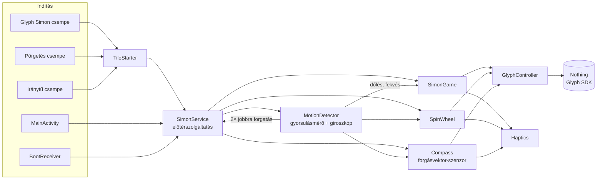
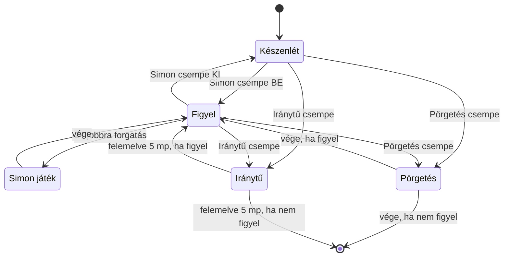

<div align="center">


# Glyph Eggs

**Játékok és eszközök a Nothing Phone (2) hátoldali Glyph LED-jeire**

Simon Says dőléssel · Üvegpörgetés · Iránytű — mindhárom egy koppintásra a lehúzható menüből


-000000)


</div>

---

## Tartalom

- [Funkciók](#funkciók)
- [Gyorsbeállítás-csempék](#gyorsbeállítás-csempék)
- [LED-térkép](#led-térkép)
- [Telepítés](#telepítés)
- [Használat](#használat)
- [Hogyan működik](#hogyan-működik)
- [A kód felépítése](#a-kód-felépítése)
- [Algoritmusok részletesen](#algoritmusok-részletesen)
- [Beállítások (`Config.kt`)](#beállítások-configkt)
- [Engedélyek](#engedélyek)
- [Hibaelhárítás](#hibaelhárítás)
- [Ismert korlátok](#ismert-korlátok)
- [Források](#források)

---

## Funkciók

| | Funkció | Röviden |
|---|---|---|
| 🎮 | **Glyph Simon** | Klasszikus Simon Says: a LED-ek mutatnak egy sort, te a telefon döntésével ismétled. 8 szint, a haladást a C1 sáv mutatja. |
| 🍾 | **Üvegpörgetés** | A fény körbefut a nagy gyűrűn, lassul, kattog, és megáll valakinél. Társasjátékhoz, döntéshez. |
| 🧭 | **Iránytű** | Fekve mutatja az északot: durván a nagy íveken, pontosan egyetlen kis LED-del a C1 sávon. |

**Közös tulajdonságok**

- Mindhárom indítható a **lehúzható gyorsbeállítás-menüből** is, saját csempével.
- A telefon **kijelzővel lefelé** fekszik az asztalon, így a LED-ek felfelé néznek.
- **Rezgéses visszajelzés**: indító jelzés, kattogó pörgetés, győzelmi rezgés.
- **Akkubarát háttérfigyelés**: készenlétben lassú, kötegelt gyorsulásmérő; a giroszkóp csak akkor fut, ha a telefon le van fektetve.
- A hivatalos **Nothing Glyph Developer Kit**-re épül. Nincs root, nincs trükközés.

---

## Gyorsbeállítás-csempék

Húzd le kétszer a felső menüt, koppints a ✏️ (szerkesztés) ikonra, és húzd be a csempéket. Vagy az appban a *„… csempe hozzáadása”* gombokkal egy koppintással felkerülnek.

| Csempe | Típus | Mit csinál |
|---|---|---|
| **Glyph Simon** | Kapcsoló | Be: a háttérben figyeli az indító mozdulatot (fekve 2× jobbra forgatás). Ki: leállítja a figyelést. A csempe világít, amíg figyel. |
| **Pörgetés** | Gomb | Elindít egy pörgetést. Megvárja, hogy kijelzővel lefelé letedd (max. 15 mp). |
| **Iránytű** | Gomb / kapcsoló | Elindítja az iránytűt; ha fut, egy újabb koppintás leállítja. A csempe világít, amíg fut. |

> A csempe a rendszer menüjében él, ezért akkor is működik, ha az app nincs megnyitva. Ha egy Android-verzió nem engedi a csempéről közvetlenül indítani a szolgáltatást, az app magától megnyílik, és onnan indul.

---

## LED-térkép

A Nothing Phone (2) hátlapján **33 külön vezérelhető zóna** van. Hátulról nézve, kamera bal felül:

```
        ┌───────────────────────────┐
        │  (A1)       B1 ╲          │   A1 / A2 – kamera körüli gyűrű (felső / alsó fél)
        │  (A2)           ╲         │   B1      – ferde csík
        │                           │
        │       C2  ╭─────╮ C1_16   │   C1_1…C1_16 – jobb felső ív, 16 kis LED
        │         ╱         ╲ …     │                (C1_16 felül, C1_1 a jobb szélen)
        │   C3   │           │ C1_1 │   C2 – bal felső ív     C3 – bal oldal
        │        │           │ C6   │   C4 – bal alsó ív      C5 – jobb alsó ív
        │       C4 ╲       ╱ C5     │   C6 – jobb oldal
        │            ╰─────╯        │
        │               │ D1_8      │   D1_1…D1_8 – függőleges vonal (D1_1 alul)
        │               │ D1_1      │
        │               •  E1       │   E1 – pont a töltőport felé
        └──────────── USB-C ────────┘
```

### Ki mit használ

| Zóna | Glyph Simon | Üvegpörgetés | Iránytű |
|---|---|---|---|
| A1, A2, B1 | **Fel** (B1 felé dönteni) | – | – |
| D1_1–D1_8, E1 | **Le** (töltőport felé) | – | – |
| C2, C3 | **Balra** (kamera felőli oldal) | mutató | durva irány |
| C5, C6 | **Jobbra** | mutató | durva irány |
| C4 | – (csak villogásban) | mutató | durva irány |
| C1_1–C1_16 | **Szintjelző** (körönként 2 LED) | mutató (2–3 kis LED) | **pontos irány, 1 LED** |

---

## Telepítés

### 1. APK építése GitHub Actions-szel (számítógép nélkül)

1. Hozz létre egy **privát** repót, és töltsd fel bele a projekt zipjét (*Add file → Upload files*). Egyszerre csak egy zip legyen a repóban.
2. Hozd létre a `.github/workflows/build.yml` fájlt az alábbi tartalommal. Ez bármilyen nevű zipet kicsomagol, megkeresi benne a projektet, és megépíti:

<details>
<summary><b>build.yml megnyitása</b></summary>

```yaml
name: APK építése
on:
  push:
  workflow_dispatch:
jobs:
  build:
    runs-on: ubuntu-latest
    steps:
      - uses: actions/checkout@v4
      - name: Kicsomagolás
        run: |
          unzip -q -o "$(ls *.zip | head -1)"
          ls -la
      - uses: actions/setup-java@v5
        with:
          distribution: temurin
          java-version: "17"
      - name: APK építése
        run: |
          cd "$(dirname "$(find . -maxdepth 2 -name gradlew | head -1)")"
          chmod +x gradlew
          ./gradlew assembleDebug --no-daemon
      - uses: actions/upload-artifact@v4
        with:
          name: glyph-eggs-apk
          path: "**/app/build/outputs/apk/debug/*.apk"
```

</details>

3. Az **Actions** fülön várd meg a zöld pipát (3–5 perc), majd a futás alján, az **Artifacts** résznél töltsd le a `glyph-eggs-apk` fájlt.

> Ha a projekt mappáját közvetlenül töltöd fel (nem zipben), a projektben lévő `.github/workflows/build-apk.yml` magától működik.

### 2. Android Studióval

`File → Open` → a `GlyphEggs` mappa → `Build → Build APK(s)`. Az APK itt lesz: `app/build/outputs/apk/debug/app-debug.apk`.

### 3. Telepítés a telefonra

1. Nyisd meg az APK-t, és engedélyezd a telepítést ismeretlen forrásból.
2. Ha a Play Protect figyelmeztet, válaszd a **Telepítés mindenképp** lehetőséget. Nem a Play Áruházból jön, ezért szól.
3. Ha fent van a régi **Glyph Simon** app, töröld, mert a Glyph Eggs tartalmazza, és a kettő zavarná egymást.

### 4. A Glyph vezérlés engedélyezése

| Rendszer | Teendő |
|---|---|
| Android 16 / Nothing OS 4 vagy újabb | Nincs, működik. |
| Régebbi | USB-n egyszer: `adb shell settings put global nt_glyph_interface_debug_enable 1` (48 óránként lejár). |

### 5. Első indítás

1. Nyisd meg az appot, és engedélyezd az **értesítéseket**.
2. **Akkumulátor-optimalizálás kikapcsolása** gomb. Enélkül a rendszer leállíthatja a háttérben.
3. Add hozzá a csempéket.
4. Próbáld ki a **Simon indítása most (teszt)** gombbal, és figyeld az *Élő szenzoradatok* részt.

---

## Használat

### 🎮 Glyph Simon

1. Kapcsold be a **Glyph Simon** csempét.
2. Tedd le a telefont kijelzővel lefelé, töltőport feléd, és **forgasd jobbra kétszer** kb. negyed fordulatot (felülről nézve óramutató irányába). Rövid rezgés jelzi, hogy felismerte.
3. A LED-ek háromszor körbefutnak, majd elindul a játék.
4. A telefon lejátssza a sort. Döntsd arra, amerre a LED villant, majd engedd vissza középre.
5. Minden körben **az egész sort** végig kell dönteni, a végén egy új iránnyal.
6. Teljesített körönként **2 új LED** gyullad ki a C1 szintjelzőn. 8 kör után a sáv betelik: kb. **8 mp-ig** minden összevissza villog, és a telefon rezeg. 🎉
7. Rossz iránynál vagy 7 mp tétlenség után vége; az elért szint még 3 mp-ig látszik.

### 🍾 Üvegpörgetés

1. Koppints a **Pörgetés** csempére.
2. Tedd le a telefont kijelzővel lefelé az asztal közepére.
3. A fénypont 4–6 kört fut a gyűrűn, 5–7 mp alatt lelassul, a végén kattogó rezgéssel kúszik.
4. Megáll: a kiválasztott hely 5-ször villog, a telefon rezeg, és 4 mp-ig égve marad. **Akire mutat, az a kiválasztott.**

### 🧭 Iránytű

1. Koppints az **Iránytű** csempére, és tedd le a telefont kijelzővel lefelé egy sík felületre. A gyűrű egyszer felvillan.
2. **Durva irány:** ha az észak a C2–C6 nagy ívek felé esik, az az ív ég.
3. **Pontos irány:** forgasd a telefont, amíg az észak a C1 sávra kerül. Kis kattanás jelzi, és onnantól **egyetlen kis LED** mutatja pontosan az északot.
4. Addig fut, amíg fekszik. Ha felemeled, még **5 mp-ig** vár: ha visszateszed, folytatja, különben kikapcsol.

---

## Hogyan működik



**A lényeg:**

- **Egyetlen előtérszolgáltatás** (`SimonService`) birtokolja a LED-eket és a szenzorokat. Állandó értesítést mutat, így az Android nem állítja le.
- Egyszerre **egy feladat** fut (Simon, pörgetés vagy iránytű). Minden feladat ugyanabban a keretben (`launchWithGlyph`) fut: Glyph-kapcsolat nyitása → feladat → takarítás.
- A Glyph sessiont **csak a feladat idejére** nyitja meg, így máskor a rendszer saját Glyph-értesítései zavartalanul működnek.
- Ha a Simon-figyelés ki van kapcsolva, a szolgáltatás egy pörgetés vagy iránytű után **magától leáll**.



---

## A kód felépítése

```
GlyphEggs/
├── app/
│   ├── libs/glyph-matrix-sdk-2.0.aar        ← Nothing hivatalos Glyph SDK
│   └── src/main/
│       ├── AndroidManifest.xml
│       ├── java/com/akos/glypheggs/
│       │   ├── SimonService.kt               ← a központi szolgáltatás
│       │   ├── MotionDetector.kt             ← szenzorok: dőlés, fekvés, forgatás
│       │   ├── GlyphController.kt            ← vékony réteg a GlyphManager körül
│       │   ├── SimonGame.kt                  ← Simon Says játékmenet
│       │   ├── SpinWheel.kt                  ← üvegpörgetés
│       │   ├── Compass.kt                    ← iránytű
│       │   ├── Direction.kt                  ← irányok és LED-zónák
│       │   ├── Haptics.kt                    ← rezgésminták
│       │   ├── Config.kt                     ← minden hangolható érték
│       │   ├── SimonTileService.kt           ← „Glyph Simon” csempe
│       │   ├── SpinTileService.kt            ← „Pörgetés” csempe
│       │   ├── CompassTileService.kt         ← „Iránytű” csempe
│       │   ├── TileStarter.kt                ← csempe → szolgáltatás indítás
│       │   ├── MainActivity.kt               ← vezérlőképernyő + élő adatok
│       │   ├── BootReceiver.kt               ← újraindítás után visszakapcsol
│       │   └── DebugState.kt                 ← állapot és napló a képernyőre
│       └── res/
│           ├── drawable/ic_tile.xml, ic_spin.xml, ic_compass.xml   ← csempe-ikonok
│           ├── drawable/ic_launcher_*.xml                          ← tojásos logó
│           └── mipmap-anydpi-v26/ic_launcher.xml                   ← adaptív ikon
├── build.gradle.kts, settings.gradle.kts, gradle.properties
├── gradlew, gradle/wrapper/
└── .github/workflows/build-apk.yml
```

### Fájlonként

| Fájl | Feladat |
|---|---|
| **`SimonService`** | Előtérszolgáltatás (`foregroundServiceType="specialUse"`). Fogadja az `ACTION_WATCH_ON/OFF`, `ACTION_START_GAME`, `ACTION_SPIN`, `ACTION_COMPASS`, `ACTION_STOP` parancsokat. A `launchWithGlyph()` keret megnyitja a Glyph sessiont, lefuttatja a feladatot, majd mindig takarít. Frissíti az értesítést és a csempék állapotát (`watching`, `compassOn`). |
| **`MotionDetector`** | Saját szálon (`HandlerThread`) olvassa a szenzorokat. Kiszűri a gravitációt (aluláteresztő szűrő), ebből adja a `tilt` (dőlés iránya) és a `faceDown` (kijelzővel lefelé fekszik-e) `StateFlow`-t. Készenlétben a giroszkóppal számolja a jobbra forgatásokat. Wake-lockkal ébren tartja a processzort, amíg kell. |
| **`GlyphController`** | A `GlyphManager` csatlakoztatása, regisztráció (`DEVICE_22111`), session nyitás/zárás, `show(zónák)`, `off()`, `progress(%)`. Minden hívás védett: zárt sessionnél nem csinál semmit. |
| **`SimonGame`** | A játékmenet coroutine-ként: bevezető animáció → sor bővítése → lejátszás → válaszok várása `tilt.first { … }`-val, időkorláttal → szintlépés → győzelem/vereség animáció. |
| **`SpinWheel`** | Szög alapú pörgetés lassuló (ease-out) mozgással, egyenletes eséllyel sorsolt célponttal. |
| **`Compass`** | A forgásvektor-szenzorból kiszámolja, merre van az észak a hátlaphoz képest, és kigyújtja a megfelelő zónát. Felemelésnél türelmi idő. |
| **`Direction` / `Zones`** | A négy dőlési irány és a hozzájuk tartozó LED-ek; `Zones.LEVEL` (C1, 16 LED) és `Zones.ALL` (mind a 33). |
| **`Haptics`** | `tick()` indító jelzés, `click()` pörgetés-kattanás, `result()` megállás, `win()` ~8 mp-es győzelmi minta. |
| **`*TileService`** | A három csempe. A Simon csempe kapcsoló (`TOGGLEABLE_TILE`), a másik kettő gomb. |
| **`TileStarter`** | Csempéről indítja a szolgáltatást; ha a rendszer ezt tiltja, `startActivityAndCollapse`-szel megnyitja az appot. |
| **`MainActivity`** | Egyszerű, kódból felépített felület: gombok, élő szenzoradatok, napló. Itt kérhető a csempék hozzáadása (`StatusBarManager.requestAddTileService`). |
| **`BootReceiver`** | Újraindítás után visszakapcsolja a Simon-figyelést, ha előtte be volt kapcsolva. |
| **`DebugState`** | `StateFlow`-k az állapotnak, a szenzoradatoknak és az utolsó 15 naplósornak; a főképernyő ezeket mutatja élőben. |

---

## Algoritmusok részletesen

<details>
<summary><b>Dőlésérzékelés (Simon)</b></summary>

A gyorsulásmérő jelét aluláteresztő szűrővel simítja (`g = α·g + (1−α)·mért`), így marad a gravitáció iránya. Kijelzővel lefelé fekve a gravitáció x és y összetevője mutatja a dőlést:

- ha `max(|x|, |y|) ≥ TILT_ON` (≈ 21°) → az erősebb tengely és az előjel adja az irányt;
- ha `< TILT_OFF` → „középen”;
- a kettő között marad az előző állapot (**hiszterézis**, nem villog a határon).

A játék minden válasz előtt megvárja a „középen” állapotot, így egy döntés pontosan egy válasz.
</details>

<details>
<summary><b>Indító mozdulat: 2× jobbra forgatás</b></summary>

Csak akkor fut, ha a telefon kijelzővel lefelé fekszik (`g.z < −FLAT_Z`). A giroszkóp z-tengelyének szögsebességét időben összegzi (integrálja):

- kijelzővel lefelé a felülről nézett óramutató-irányú forgatás pozitív z-szögsebességet ad;
- a zajt (`|ω| < 0,15 rad/s`) eldobja; a balra forgatás nullázza a félkész forgatást;
- egy forgatás akkor számít, ha eléri `TURN_DEGREES × TURN_TOLERANCE` értéket (≈ 68°);
- a forgatások között legfeljebb `TURN_GAP_MS` telhet el, különben újrakezdi.

A giroszkóp csak lefektetett telefonnál fut, készenlétben a gyorsulásmérő ~5 Hz-en, 1 mp-es kötegekben jár, ez kíméli az akkut.
</details>

<details>
<summary><b>Üvegpörgetés</b></summary>

A gyűrű minden zónájához szögtartomány tartozik (0° = felül, óramutató irányában). A célszöget **egyenletesen sorsolja 0–360° között**, így minden irány azonos eséllyel jön ki, akkor is, ha a C1 16 kis LED-je sűrűbb.

A teljes elfordulás `fordulatok × 360° + (cél − kezdet)`, a mozgás pedig ease-out görbét követ:

```
szög(t) = kezdet + teljes · (1 − (1 − t)^SPIN_EASE_POWER)
```

Az elején gyors, a végén kúszik. A „mutató” a szög körüli ±`SPIN_POINTER_HALF_WIDTH` fokos sáv, így a C1-en 2–3 kis LED ég egyszerre. A lassuló szakaszban minden zónaváltás egy kis kattanó rezgés.
</details>

<details>
<summary><b>Iránytű</b></summary>

A `TYPE_ROTATION_VECTOR` szenzor (gyorsulásmérő + magnetométer + giroszkóp összefésülve) adja a telefon helyzetét. A forgatási mátrixból a telefon tetejének (+Y tengely) iránya:

```
irány = atan2(kelet, észak) = atan2(R[1], R[4])
```

Ez kijelzővel lefelé is helyes, mert csak az Y tengely vízszintes vetületét használja. Az észak a hátlapon ennek az ellentettje: `észak_szög = −irány` (+ mágneses elhajlás, ha be van állítva).

- **Simítás:** szinusz/koszinusz átlag, így a 359° → 0° átmenet nem ugrik.
- **Hiszterézis:** csak akkor vált zónát, ha már `COMPASS_HYSTERESIS` fokkal benne van, ezért nem villódzik a határon.
- **Durva / pontos:** C2–C6 nagy ívek → durva irány; C1 (16 × 5,6°) → egyetlen LED, belépéskor kattanás.
- **Leállás:** ha `faceDown` hamis lesz, indul egy `COMPASS_LIFT_GRACE_MS` időzítő; ha közben visszateszed, folytatja.
</details>

---

## Beállítások (`Config.kt`)

Minden hangolható érték egy helyen: `app/src/main/java/com/akos/glypheggs/Config.kt`. Módosítás után újra kell építeni az APK-t.

<details open>
<summary><b>Glyph Simon</b></summary>

| Név | Alap | Jelentés |
|---|---|---|
| `FULL_SEQUENCE` | `true` | `true`: az egész sort kell végigdönteni · `false`: csak az újat |
| `LEDS_PER_LEVEL` | `2` | Ennyi LED gyullad körönként a C1 szintjelzőn |
| `MAX_ROUNDS` | `8` | 16 / `LEDS_PER_LEVEL` – ennyi kör a győzelemhez |
| `TURN_COUNT` | `2` | Ennyi jobbra forgatás indítja a játékot |
| `TURN_DEGREES` / `TURN_TOLERANCE` | `90°` / `0.75` | Egy forgatás mérete és a tűrés |
| `TURN_GAP_MS` | `4000` | Max. szünet két forgatás között |
| `INVERT_TURN` | `false` | Ha a jobbra forgatást nem számolja, de a balrát igen |
| `TILT_ON` / `TILT_OFF` | `3.5` / `1.5` | Dőlés küszöbe és a „középen” határa (m/s²) |
| `INVERT_X` / `INVERT_Y` | `false` | Ha a bal/jobb vagy fel/le fordítva jön ki |
| `SHOW_MS` / `GAP_MS` | `300` / `150` | Lejátszás tempója |
| `ANSWER_TIMEOUT_MS` | `7000` | Ennyi idő van egy válaszra |
| `WIN_FLASH_MS` | `8000` | Győzelmi villogás hossza |
</details>

<details>
<summary><b>Üvegpörgetés</b></summary>

| Név | Alap | Jelentés |
|---|---|---|
| `SPIN_MIN_TURNS` / `SPIN_MAX_TURNS` | `4` / `6` | Ennyi teljes kört fut |
| `SPIN_MIN_MS` / `SPIN_MAX_MS` | `5000` / `7000` | A pörgetés hossza |
| `SPIN_EASE_POWER` | `3` | Lassulás erőssége (nagyobb = hosszabb kúszás) |
| `SPIN_POINTER_HALF_WIDTH` | `6°` | A fénypont szélessége |
| `SPIN_HOLD_MS` | `4000` | Ennyi ideig ég az eredmény |
| `SPIN_PLACE_TIMEOUT_MS` | `15000` | Ennyit vár a lerakásra |
</details>

<details>
<summary><b>Iránytű</b></summary>

| Név | Alap | Jelentés |
|---|---|---|
| `COMPASS_DECLINATION` | `0` | Mágneses elhajlás fokban. Földrajzi északhoz Magyarországon ≈ `5.5` |
| `COMPASS_INVERT` | `false` | Ha tükrözve mutat (keletet nyugat helyett) |
| `COMPASS_LIFT_GRACE_MS` | `5000` | Felemelés után ennyit vár a leállással |
| `COMPASS_SMOOTHING` | `0.85` | Simítás (nagyobb = nyugodtabb, lassabb) |
| `COMPASS_HYSTERESIS` | `1.2°` | Villódzás elleni küszöb |
| `COMPASS_PLACE_TIMEOUT_MS` | `20000` | Ennyit vár a lerakásra |
</details>

---

## Engedélyek

| Engedély | Miért kell |
|---|---|
| `com.nothing.ketchum.permission.ENABLE` | A Glyph LED-ek vezérlése |
| `FOREGROUND_SERVICE`, `FOREGROUND_SERVICE_SPECIAL_USE` | Háttérben futó figyelés állandó értesítéssel |
| `POST_NOTIFICATIONS` | Az állandó értesítés megjelenítése |
| `WAKE_LOCK` | Kikapcsolt képernyőnél is fut a szenzorfigyelés és az animáció |
| `VIBRATE` | Rezgéses visszajelzés |
| `RECEIVE_BOOT_COMPLETED` | Újraindítás után visszakapcsolja a figyelést |
| `REQUEST_IGNORE_BATTERY_OPTIMIZATIONS` | Az akkuoptimalizálás kikapcsolásának kérése |

Az app **nem kér** internet-, hely-, kamera- vagy mikrofon-hozzáférést.

---

## Hibaelhárítás

| Tünet | Megoldás |
|---|---|
| Nem gyulladnak ki a LED-ek | Régebbi rendszeren add ki az `adb` parancsot (48 óránként lejár). A naplóban `openSession hiba` jelenik meg. |
| A Simon nem indul a forgatásra | Nézd az élő adatoknál a „jobbra forgatás: x/2” számlálót. Ha balra forgatásra nő, állítsd `INVERT_TURN = true`-ra. |
| Fordítva érzékeli a dőlést | `INVERT_X` / `INVERT_Y` |
| Az iránytű tükrözve mutat | `COMPASS_INVERT = true` |
| Az iránytű téved | Fém, laptop, hangszóró van a közelben. Emeld fel, és mozgasd párszor 8-as alakban. |
| A háttérben leáll | Kapcsold ki az akkuoptimalizálást az appban. |
| Furcsán viselkedik lefelé fordításkor | A Nothing **Flip to Glyph** funkciója ütközhet. Kapcsold ki a Glyph beállításokban. |
| A csempe nem indít semmit | Az app ilyenkor magától megnyílik. Ha mégsem, indítsd az app gombjával. |

---

## Ismert korlátok

- Csak **Nothing Phone (2)**-re készült (`DEVICE_22111`). Más Nothing telefonokon más a zónakiosztás.
- Amíg egy feladat fut, a rendszer saját Glyph-értesítései szünetelnek.
- A C2–C6 ívek pontos szöghatárait a Nothing nem dokumentálja, ezért becsültek. A sorrendjük biztos.
- Az iránytű alapból a mágneses északot mutatja.

---

## Források

- [Nothing Glyph Developer Kit](https://github.com/Nothing-Developer-Programme/Glyph-Developer-Kit): hivatalos SDK és zóna-indexelés
- [SebiAi / custom-nothing-glyph-tools](https://github.com/SebiAi/custom-nothing-glyph-tools): a Phone (2) Glyph-zónák részletes leírása

<div align="center">

---

Készült egy Nothing Phone (2)-höz, sok dőlögetéssel és pörgetéssel. 🥚✨

</div>
