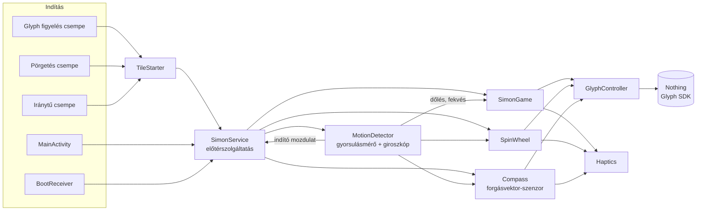
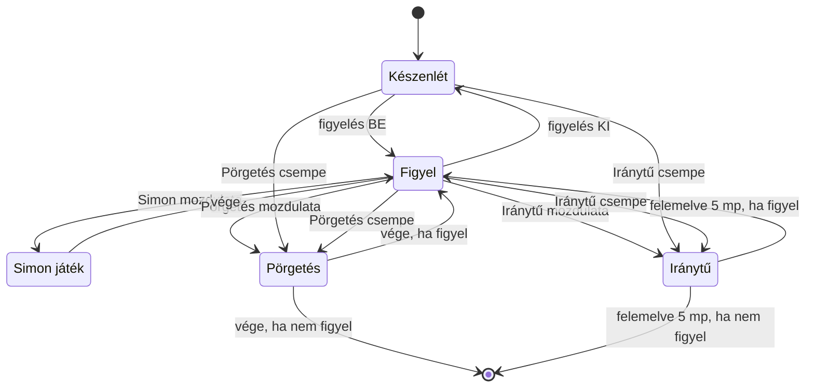

<div align="center">


# Glyph Eggs

**Játékok és eszközök a Nothing Phone (2) hátoldali Glyph LED-jeire**

Simon Says · Zárfeltörő · Glyph Tojás · Egyensúly · Dínófutás · Széf · Üvegpörgetés · Iránytű · Vízmérték · Időzítő — csempéről, widgetről vagy saját mozdulattal


-000000)


</div>

---

## Tartalom

- [Újdonságok](#újdonságok)
- [Funkciók](#funkciók)
- [Gyorsbeállítás-csempék](#gyorsbeállítás-csempék)
- [Felület](#felület)
- [Widgetek](#widgetek)
- [Ikon](#ikon)
- [Zárfeltörő](#-zárfeltörő)
- [Egyensúly](#-egyensúly)
- [Dínófutás](#-dínófutás)
- [Vízmérték](#-vízmérték)
- [Időzítő](#-időzítő)
- [Glyph Tojás](#-glyph-tojás)
- [Széf](#-széf)
- [Indító mozdulatok](#indító-mozdulatok)
- [LED-szimuláció](#led-szimuláció)
- [LED-térkép](#led-térkép)
- [Telepítés](#telepítés)
- [Használat](#használat)
- [Hogyan működik](#hogyan-működik)
- [A kód felépítése](#a-kód-felépítése)
- [Algoritmusok részletesen](#algoritmusok-részletesen)
- [Beállítások (`Config.kt`)](#beállítások-configkt)
- [Engedélyek](#engedélyek)
- [Hibaelhárítás](#hibaelhárítás)
- [Ismert korlátok](#ismert-korlátok)
- [Források](#források)

---

## Újdonságok

### 9.0 – új ikon
- **Pontmátrixos logó**: a tojás a Nothing pöttyös (dot-matrix) stílusában, rajta a világító Glyph-minta és a piros E1 pont. Részletek: [Ikon](#ikon).
- A kamera melletti **ferde LED (B1) iránya javítva** (`/`, ahogy a telefonon) – az ikonon és a LED-térképen is.
- **Témás ikon** (Android 13+ „témás ikonok”): egyszínű pontmátrixos változat, a háttérképhez színeződik.
- A **Glyph Tojás widget** is az új logót mutatja.

### 8.0 – widgetek
- Négy widget: **Gyorsindító sáv** (4 választható funkció + figyelés kapcsoló), **Egygombos funkció** (bármelyikhez, többször is), **Glyph Tojás** (állapot + gondozás az app megnyitása nélkül), **Időzítő** (élő visszaszámlálás).
- Lerakáskor beállítható, később hosszú nyomással átkonfigurálható; az appból egy koppintással kitehető.

### 7.0 és korábban
- Új játékok: **Zárfeltörő** (édes-pont rezgéssel), **Glyph Tojás**, **Egyensúly**, **Dínófutás**; új eszközök: **Széf**, **Vízmérték** (bármilyen helyzetben), **Időzítő** (homokóra és más animációk, többféle fókusz-mód).
- Fülekre rendezett, testreszabható Nothing-stílusú felület, „i” súgóoldalak, minden funkcióhoz gyorscsempe.
- Programozható indító mozdulatok, köztük a **Hengerítés 3×**; a LED-szimuláció a Beállításokba költözött.

---

## Funkciók

| | Funkció | Röviden |
|---|---|---|
| 🎮 | **Glyph Simon** | Klasszikus Simon Says: a LED-ek mutatnak egy sort, te a telefon döntésével ismétled. 8 szint, a haladást a C1 sáv mutatja. |
| 🍾 | **Üvegpörgetés** | A fény körbefut a nagy gyűrűn, lassul, kattog, és megáll valakinél. Társasjátékhoz, döntéshez. |
| 🔓 | **Zárfeltörő** | Ügyességi játék: a C1 sávon csúszó fénynél akkor kopogj, amikor a rejtett édes ponton jár. 4 tüske, 3 élet. |
| 🥚 | **Glyph Tojás** | Tamagocsi a hátlapon: kikel, nő, eszik, játszik, alszik, kakil, beteg lesz – kopogással és rázással gondozod. |
| 🔐 | **Széf** | LED-villanásokból álló titkos kód rázással; helyes kódra fényshow, rezgés és megnyílik a titkos jegyzet, egy mappa, app vagy weboldal. |
| ⚖️ | **Egyensúly** | Döntéssel tartsd a fénypontot a sávon, miközben a szél lökdösi. 80 mp-et kell kibírni. |
| 🦖 | **Dínófutás** | A böngésző dínós játéka a felső sávon: kopogj, hogy átugord a kaktuszt; a villogó madár fölött ne ugorj. |
| 📏 | **Vízmérték** | Fekve, hosszú élére állítva vagy töltőporton állva; pont vízszintesnél a két oldal / két vég egyszerre gyullad. |
| ⏳ | **Időzítő** | Pomodoro és más fókusz-időzítők homokórás és más LED-animációkkal – nem kell a képernyőt nézni. |
| 🧭 | **Iránytű** | Fekve mutatja az északot: durván a nagy íveken, pontosan egyetlen kis LED-del a C1 sávon. |
| ✋ | **Indító mozdulatok** | Forgatás, megpörgetés, kopogás, rázás, lefordítás – bármelyik funkcióhoz bármelyik mozdulat. |
| 🧩 | **Widgetek** | Gyorsindító sáv, egygombos funkció, Tojás-állapot és élő időzítő a kezdőképernyőn. |
| 👁️ | **LED-szimuláció** | A képernyőn is látszik, mit csinálnak a LED-ek – akár Glyph nélküli telefonon is. |

**Közös tulajdonságok**

- Minden funkció indítható a **lehúzható gyorsbeállítás-menüből** csempével, **widgetről** és **saját indító mozdulattal** is.
- **Nothing-stílusú felület**: ugyanaz a sötét, kártyás megjelenés, mint a telefon Glyph Interface beállításaiban, élő Glyph-előnézettel.
- A telefon **kijelzővel lefelé** fekszik az asztalon, így a LED-ek felfelé néznek.
- **Rezgéses visszajelzés**: indító jelzés, kattogó pörgetés, győzelmi rezgés.
- **Akkubarát háttérfigyelés**: készenlétben lassú, kötegelt gyorsulásmérő; a giroszkóp csak akkor fut, ha a telefon le van fektetve.
- A hivatalos **Nothing Glyph Developer Kit**-re épül. Nincs root, nincs trükközés.

---

## Gyorsbeállítás-csempék

Húzd le kétszer a felső menüt, koppints a ✏️ (szerkesztés) ikonra, és húzd be a csempéket. Vagy az appban a *„… csempe hozzáadása”* gombokkal egy koppintással felkerülnek.

| Csempe | Típus | Mit csinál |
|---|---|---|
| **Glyph figyelés** | Kapcsoló | Be: a háttérben figyeli a beállított indító mozdulatokat, és elindítja a hozzájuk rendelt funkciót. Ki: leállítja a figyelést. A csempe világít, amíg figyel. |
| **Pörgetés** | Gomb | Elindít egy pörgetést. Megvárja, hogy kijelzővel lefelé letedd (max. 15 mp). |
| **Iránytű** | Gomb / kapcsoló | Elindítja az iránytűt; ha fut, egy újabb koppintás leállítja. A csempe világít, amíg fut. |
| **Zárfeltörő** | Gomb / kapcsoló | Elindítja a játékot (le kell tenni kijelzővel lefelé). |
| **Széf** | Gomb / kapcsoló | Elindítja a kódbevitelt. |
| **Glyph Tojás** | Gomb / kapcsoló | A Tojás megjelenik a LED-eken, és kopogással gondozhatod. |
| **Vízmérték** | Gomb / kapcsoló | Fekve, élére vagy töltőportra állítva mér. |
| **Időzítő** | Gomb / kapcsoló | Elindítja a beállított fókusz-időzítőt. |
| **Egyensúly** | Gomb / kapcsoló | Elindítja a játékot. |
| **Dínófutás** | Gomb / kapcsoló | Elindítja a játékot – kopogással ugrasz. |

> Minden funkciónál igaz: ha fut, ugyanaz a csempe (vagy mozdulat) leállítja.

> A csempe a rendszer menüjében él, ezért akkor is működik, ha az app nincs megnyitva. Ha egy Android-verzió nem engedi a csempéről közvetlenül indítani a szolgáltatást, az app magától megnyílik, és onnan indul.

---

## Felület

A főképernyő a Nothing Glyph Interface stílusát követi: felül az élő Glyph-kép, mellette a **Most fut** kártya (koppintás = leállítás) és az **Újra** kártya (az utoljára használt funkció egy koppintással), alatta a **Mozdulatfigyelés** kapcsoló. A funkciók fülekre vannak rendezve:

| Fül | Tartalom |
|---|---|
| **Főoldal** | A kitűzött funkciók – alapból Iránytű, Pörgetés, Glyph Simon, Széf. A **Testreszabás** kártyával vagy bármelyik kártya **hosszú nyomásával** változtatható. |
| **Játékok** | Glyph Simon, Zárfeltörő, Glyph Tojás, Egyensúly, Dínófutás |
| **Eszközök** | Pörgetés, Iránytű, Széf, Vízmérték, Időzítő + a Széf és az Időzítő beállítása |
| **Beállítások** | Indító mozdulatok, Csempék (választható), Háttérfutás, Rezgés, LED-szimuláció, Diagnosztika |

Minden funkció-kártyán van egy **„i” gomb**: részletes súgó arról, hogyan indul, hogyan kell használni, és mit jelentenek a LED-ek – onnan egy koppintással indítható, vagy beállítható az indító mozdulata.

## Widgetek

Négyféle widget tehető a kezdőképernyőre, mind Nothing-stílusban, és mind élőben követi, mi fut.
Kitétel: **Beállítások → Widgetek** az appban, vagy hosszan nyomva a kezdőképernyőt → Widgetek → Glyph Eggs.

| Widget | Méret | Tudja |
|---|---|---|
| **Gyorsindító sáv** | 4×2 (átméretezhető) | 4 választható funkció (lerakáskor választod, később hosszú nyomás → átkonfigurálás), a futó funkció világos gombbal; **Figyel** kapcsoló a mozdulatfigyeléshez; koppintás a futóra = leállítás |
| **Egygombos funkció** | 1×1 | Bármelyik funkcióhoz, többször is kitehető; világít, amíg a funkció fut |
| **Glyph Tojás** | 4×2 | A Tojás „portréja” a Glyph-rajzon a hangulata szerint, 4 állapotsáv (pirosan, ha alacsony), gyors gondozás: etetés, játék, simogatás, fürdetés – az app megnyitása nélkül |
| **Időzítő** | 4×1 | Magától visszaszámol (a szakasz nevével), szünetnél megáll; Indítás / Leállítás gomb; koppintás = beállítások |

<p align="center"></p>

## Ikon

<p align="center"></p>

- **Pontmátrixos tojás**: a Nothing pöttyös betűtípusára és felületére utal; a pöttyök pontosan a tojás körvonalát követik.
- Rajta a **Phone (2) hátlapjának Glyph-mintája** világítva: kameragyűrű (A), ferde csík (B1, `/` irányban), a nagy gyűrű szakaszokra bontva (C), a függőleges vonal (D1) és a **piros E1 pont**.
- **Adaptív ikon**: fekete háttér + vektoros előtér, így bármilyen indítóikon-formában (kör, squircle, lekerekített négyzet) éles. A „fény” áttetsző vonalrétegekből áll, mert a vektoros ikonban nincs elmosás.
- **Témás ikon**: egyszínű változat, amit az Android a háttérkép színeihez igazít.
- Fájlok: `drawable/ic_launcher_foreground.xml`, `ic_launcher_background.xml`, `ic_launcher_monochrome.xml`; a README-logó: `glyph-eggs-logo.png` (256×256, átlátszó sarkok).

## 🔓 Zárfeltörő

Az RPG-kből ismert zárfeltörés a hátlapon.

1. Koppints a **Zárfeltörő** kártyára vagy csempére, és tedd le a telefont kijelzővel lefelé.
2. A **C1 sávon** (16 kis LED) egy fénypont csúszik ide-oda. Valahol a sáv közepe táján van egy **rejtett édes pont**.
3. Amikor a fény az édes pontra ér, a telefon **egy kicsit rezzen**. Erre **kopogj a telefonon** (a szimulációban az *Érintés* gomb is jó). A reakcióidőt figyelembe veszi: a rezzenés után kb. 0,3 mp-ig még talál.
4. **Közel jártál** (1–2 LED): a fény és a cél közti LED-ek kétszer felvillannak – így látod, hogy túl korán vagy túl későn nyomtad. Ez nem kerül életbe.
5. **Nagyon mellé**: elvész egy élet. Az életeket a kamera két fele és a ferde csík mutatja (3 élet).
6. **Talált**: kattan a zár (fényhullám, rezgés). A kinyitott tüskéket a D1 vonal mutatja; tüskénként gyorsul a fény.
7. Mind a **4 tüske** nyitva: nagy fényáradat és rezgés. A legjobb eredményedet a főképernyő mutatja.

## ⚖️ Egyensúly

1. Indítsd, és tedd le kijelzővel lefelé (vagy tartsd vízszintesen a kezedben).
2. A **felső sávon** egy fénypont gurul, mint golyó a deszkán: amerre lejt a telefon, arra gurul.
3. **Szél** lökdösi. Hogy merről fúj, azt az oldalsó ívek mutatják (bal vagy jobb) – ellene kell dönteni.
4. Ha leesik a sáv végéről, elvész egy élet (a kamera két fele és a ferde csík: 3 élet). A sáv szélén a pont pislogva figyelmeztet.
5. 10 mp-enként egy LED gyullad a **D1 vonalon**; ha mind a 8 ég (80 mp), nyertél. Az idővel a szél erősödik.

## 🦖 Dínófutás

1. Indítsd, és tedd le kijelzővel lefelé. A **felső sáv** a pálya: a dínó a bal végén, jobbról jönnek az akadályok.
2. **Kaktusz** (égő fény): **kopogj** – a dínó átugorja. Ugrás közben „fent” van: a ferde csík és a kamera teteje ég.
3. **Madár** (villogó fény, 8 pont után): **ne ugorj**, átrepül fölötted.
4. Egyre gyorsabb; 100 pontonként minden felvillan. 10 pontonként egy LED gyullad a D1 vonalon.
5. Ütközésnél a pontszám: a vonal a tízeseket, a felső sáv az egyeseket mutatja. A rekordot a kártya mutatja.

## 📏 Vízmérték

A helyzetet magától felismeri – három módon használható:

| Helyzet | Mit mér | Ha nem vízszintes | Ha vízszintes |
|---|---|---|---|
| **Fekve** (kijelzővel lefelé) | bal–jobb és előre–hátra | a magasabb oldal / vég ég | a két oldali ív és a két vég **egyszerre** ég |
| **Hosszú élére állítva** / fekvő tájolásban falhoz tartva | a telefon hossza mentén | a magasabb vég ég (kamera vagy töltőport felőli) | **mindkét vég** egyszerre ég |
| **Töltőporton állva** | a rövid oldal mentén | a magasabb oldal íve ég | **mindkét oldal** egyszerre ég |

- A **felső sáv** mutatja az eltérés nagyságát: LED-enként 0,5°; 1° alatt a vége pislog.
- Teljesen vízszintes (0,5°-on belül): **minden felvillan** és kicsit rezeg.
- **Kalibrálás** helyzetenként: vízszintes felületen 2 kopogás = nulla, 3 = törlés (állítva a szimuláció Érintés gombjával).
- Magától kikapcsol, ha 5 percig nem mozdul.

## ⏳ Időzítő

Fókusz-időzítő a LED-eken, hogy ne kelljen a képernyőt nézned. Az **Időzítő beállítása** oldalon (Eszközök fül) választasz, élő előnézettel.

**Fajták:**

| Fajta | Felépítés |
|---|---|
| Pomodoro | 25 perc fókusz / 5 perc szünet × 4, a végén 15 perc |
| Rövid Pomodoro | 15 / 3 × 4, a végén 10 perc |
| Mély fókusz | 50 / 10 × 3, a végén 20 perc |
| 52 / 17 | 52 perc munka / 17 perc szünet × 3 |
| Sprint | 10 / 2 × 5 |
| Egyszeri időzítő | 1–90 perc, egy visszaszámlálás |
| Homokóra | rövid, pl. 1–5 perc (fogmosás, tea, társasjáték) |

**Animációk:**

| Animáció | Hogyan néz ki |
|---|---|
| **Homokóra** | Felül (kamera, felső sáv) fogy a homok; egy szem kb. 1,5 mp-enként végigesik a gyűrű jobb oldalán és a függőleges vonalon a **töltőportnál lévő pontig**, alul gyűlik, és alulról felfelé megtelik |
| Fogyó sáv | A felső sáv LED-enként fogy, az utolsó pislog |
| Óramutató | Fénypont jár körbe a gyűrűn, mögötte megtelik |
| Lélegző | 4 mp be, 4 mp ki ritmusban lélegzik a gyűrű; a vonal mutatja az időt |
| Eső | Cseppek hullanak, egyre sűrűbben, ahogy fogy az idő |
| Csak a vége | Teljes sötét, 10 mp-enként egy apró jel – semmi nem zavar |

Szünetekben mindig a lélegző gyűrű megy (pihenés). **Kopogással:** 1 = hátralévő idő 3 mp-re, 2 = szünet / folytatás, 3 = következő szakasz. Szakasz végén rezgés és villogás, a végén ünneplés. Felemelés nem állítja le; az értesítésben látod a hátralévő időt.

## 🥚 Glyph Tojás

Tamagocsi, ami a Glyph LED-eken él. A **Glyph Tojás** kártyán megnyílik a saját oldala élő LED-képpel, állapotjelzőkkel és gondozó gombokkal.

**Élete:** tojásként kezdi (3 gondoskodás vagy 20 perc után kikel) → **Kicsi** → 1 nap után **Kamasz** → 3 nap után **Felnőtt**. Az idő akkor is telik, ha nem nézed: éhes lesz, unatkozik, elfárad, kakil. Ha sokáig elhanyagolod, beteg lesz; ha sokáig beteg, elköltözik, és új tojás jön.

**Mit látsz a hátlapon:**

| Rész | Jelentés |
|---|---|
| A1 + A2 (kamera) | Szemek – pislog; szomorúan csak az egyik ég |
| B1 (ferde csík) | Antenna – ha vidám vagy már kamasz |
| C1 sáv | A teste: boldogan ugrál, elégedetten „lélegzik”; nagyobb korban nagyobb |
| D1 vonal | Szomorúan könnycsepp fut rajta |
| C4 (alsó ív) | Betegen villog |
| E1 (pont) | Kaki – ha villog, már sok van |
| Pár mp-enként | Állapotjelzés a C1-en: C2 = jóllakottság, C3 = kedv, C5 = energia, C6 = tisztaság |

**Gondozás a LED-eken** (Tojás csempe vagy a „Tojás a LED-eken” kapcsoló, majd tedd le kijelzővel lefelé):

| Mozdulat | Művelet | Animáció |
|---|---|---|
| 1 kopogás | Simogatás | szívecske, dorombolás-rezgés |
| 2 kopogás | Etetés | a falat felmegy a vonalon, „nyam-nyam” rezgés |
| 3 kopogás | Játék | labdakergetés a gyűrűn |
| 4 kopogás | Altatás / ébresztés | a fények kialszanak / felgyúlnak |
| rázás | Fürdetés | fentről lefelé „lemossa”, csillogás |
| döntés | – | arra néz, amerre döntöd |

A **gyógyítás** az app oldaláról érhető el. Óránként ránéz, és ha valami kell neki, **értesítést** küld (kikapcsolható). Amíg a Tojás oldala nyitva van, kijelzővel felfelé is gondozhatod, és a képernyőn látod az animációkat.

## 🔐 Széf

1. Állítsd be a **Széf beállítása** kártyán:
   - **Kód:** 4 mező, mindegyik a hátlap 8 részének egyike (Kamera, Ferde csík, Felső ív, Jobb oldal, Alsó ív, Bal oldal, Vonal, Pont). Koppints egy mezőre a váltáshoz – a kis rajz mutatja, melyik rész az.
   - **Kiválasztás:** rázás (alap) vagy kopogás.
   - **Mi nyíljon meg:** titkos jegyzetek (beépített), egy mappa a telefonon, egy app vagy egy weboldal – vagy semmi.
   - **Azonnali megnyitás:** a „megjelenés más appok felett” engedéllyel rögtön megnyílik; enélkül egy értesítésre kell koppintani (ez az Android biztonsági szabálya).
2. Indítsd a **Széf** kártyával, csempével vagy mozdulattal.
3. A 8 rész **véletlen sorrendben** egyenként felvillan. Amikor a kódod következő része világít, **rázd meg** a telefont. Rövid villogás és rezgés jelzi a választást, utána a kör újraindul.
4. 4 választás után: **jó kód** → kb. 5 mp-ig minden lehetséges kombinációban villog, rezeg, és megnyílik a cél. **Rossz kód** → lassú villogás, hosszú rezgés.

A **titkos jegyzetek** csak a széf kinyitása után 2 percig nyithatók meg, egyszer; róluk képernyőkép sem készülhet.

## Indító mozdulatok

A főképernyő **Mozdulatfigyelés** kapcsolójával (vagy a *Glyph figyelés* csempével) bekapcsolva a telefon a háttérben figyeli a mozdulatokat. Az **Indító mozdulatok** kártyára koppintva funkciónként választhatsz:

| Mozdulat | Hogyan | Alapból |
|---|---|---|
| Jobbra forgatás 2× | Fekve kétszer kb. negyed fordulat jobbra | **Glyph Simon** |
| Balra forgatás 2× | Fekve kétszer kb. negyed fordulat balra | – |
| Jobbra, majd balra | Negyed fordulat jobbra, aztán vissza | – |
| Balra, majd jobbra | Negyed fordulat balra, aztán vissza | – |
| Megpörgetés | Egy lendülettel legalább egy teljes kör az asztalon | **Pörgetés** |
| Kopogás 2× | Fekve kétszer gyorsan kopogtass a telefonon | **Iránytű** |
| Kopogás 3× | Fekve háromszor gyorsan | – |
| Rázás, majd lerakás | Rázd meg, és 6 mp-en belül tedd le kijelzővel lefelé | – |
| Lefordítás 2× | Kijelzővel felfelé → lefelé, kétszer egymás után | – |
| Hengerítés 3× | Két kézben, fekvő helyzetben magad előtt (töltőport a jobb kezed felé): 3-szor körbe a hosszanti tengely körül, mint egy sodrófát | – |
| Nincs | Csak csempével vagy az appból indul | – |

- **Bármelyik mozdulat bármelyik funkcióhoz** rendelhető – a Zárfeltörőhöz, a Széfhez és a Tojáshoz is (alapból ezeknek nincs). Egy mozdulat egyszerre csak egy funkcióhoz tartozhat: ha máshol már használtad, ott „Nincs” lesz.
- A **kopogás érzékenysége** (alacsony / közepes / magas) ugyanitt állítható.
- Felismeréskor rövid rezgés jelez. Egy mozdulat után 4 mp-ig nem figyel újat, hogy ne induljon kétszer.

## LED-szimuláció

**Beállítások fül → LED-szimuláció** kártya (vagy gyorsan: **dupla koppintás a „Glyph Eggs” címre**): teljes képernyőn megjelenik a hátlap Glyph-rajza, és élőben mutatja, melyik LED ég.

- Bármelyik telefonon működik. Glyph nélkül a funkciók „csak a képernyőn” futnak, így megmutathatod másnak is, hogyan működik.
- Amíg a szimuláció nyitva van, a funkciók **kijelzővel felfelé** fekvő telefonnal is indulnak. Ilyenkor a rajz tükrözve jelenik meg, hogy minden LED a valódi helyén látsszon (a kamera felőli oldal ott, ahol a kamera van).
- Alul gombokkal is indíthatod a Simont, a pörgetést és az iránytűt. Kilépés: dupla koppintás a rajzra.

---

## LED-térkép

A Nothing Phone (2) hátlapján **33 külön vezérelhető zóna** van. Hátulról nézve, kamera bal felül:

```
        ┌───────────────────────────┐
        │  (A1)      ╱ B1           │   A1 / A2 – kamera körüli gyűrű (felső / alsó fél)
        │  (A2)    ╱                │   B1      – ferde csík
        │                           │
        │       C2  ╭─────╮ C1_16   │   C1_1…C1_16 – jobb felső ív, 16 kis LED
        │         ╱         ╲ …     │                (C1_16 felül, C1_1 a jobb szélen)
        │   C3   │           │ C1_1 │   C2 – bal felső ív     C3 – bal oldal
        │        │           │ C6   │   C4 – bal alsó ív      C5 – jobb alsó ív
        │       C4 ╲       ╱ C5     │   C6 – jobb oldal
        │            ╰─────╯        │
        │               │ D1_8      │   D1_1…D1_8 – függőleges vonal (D1_1 alul)
        │               │ D1_1      │
        │               •  E1       │   E1 – pont a töltőport felé
        └──────────── USB-C ────────┘
```

### Ki mit használ

| Zóna | Glyph Simon | Üvegpörgetés | Iránytű |
|---|---|---|---|
| A1, A2, B1 | **Fel** (B1 felé dönteni) | – | – |
| D1_1–D1_8, E1 | **Le** (töltőport felé) | – | – |
| C2, C3 | **Balra** (kamera felőli oldal) | mutató | durva irány |
| C5, C6 | **Jobbra** | mutató | durva irány |
| C4 | – (csak villogásban) | mutató | durva irány |
| C1_1–C1_16 | **Szintjelző** (körönként 2 LED) | mutató (2–3 kis LED) | **pontos irány, 1 LED** |

---

## Telepítés

### 1. APK építése GitHub Actions-szel (számítógép nélkül)

1. Hozz létre egy **privát** repót, és töltsd fel bele a projekt zipjét (*Add file → Upload files*). Egyszerre csak egy zip legyen a repóban.
2. Hozd létre a `.github/workflows/build.yml` fájlt az alábbi tartalommal. Ez bármilyen nevű zipet kicsomagol, megkeresi benne a projektet, és megépíti:

<details>
<summary><b>build.yml megnyitása</b></summary>

```yaml
name: APK építése
on:
  push:
  workflow_dispatch:
jobs:
  build:
    runs-on: ubuntu-latest
    steps:
      - uses: actions/checkout@v4
      - name: Kicsomagolás
        run: |
          unzip -q -o "$(ls *.zip | head -1)"
          ls -la
      - uses: actions/setup-java@v5
        with:
          distribution: temurin
          java-version: "17"
      - name: APK építése
        run: |
          cd "$(dirname "$(find . -maxdepth 2 -name gradlew | head -1)")"
          chmod +x gradlew
          ./gradlew assembleDebug --no-daemon
      - uses: actions/upload-artifact@v4
        with:
          name: glyph-eggs-apk
          path: "**/app/build/outputs/apk/debug/*.apk"
```

</details>

3. Az **Actions** fülön várd meg a zöld pipát (3–5 perc), majd a futás alján, az **Artifacts** résznél töltsd le a `glyph-eggs-apk` fájlt.

> Ha a projekt mappáját közvetlenül töltöd fel (nem zipben), a projektben lévő `.github/workflows/build-apk.yml` magától működik.

### 2. Android Studióval

`File → Open` → a `GlyphEggs` mappa → `Build → Build APK(s)`. Az APK itt lesz: `app/build/outputs/apk/debug/app-debug.apk`.

### 3. Telepítés a telefonra

1. Nyisd meg az APK-t, és engedélyezd a telepítést ismeretlen forrásból.
2. Ha a Play Protect figyelmeztet, válaszd a **Telepítés mindenképp** lehetőséget. Nem a Play Áruházból jön, ezért szól.
3. Ha fent van a régi **Glyph Simon** app, töröld, mert a Glyph Eggs tartalmazza, és a kettő zavarná egymást.

### 4. A Glyph vezérlés engedélyezése

| Rendszer | Teendő |
|---|---|
| Android 16 / Nothing OS 4 vagy újabb | Nincs, működik. |
| Régebbi | USB-n egyszer: `adb shell settings put global nt_glyph_interface_debug_enable 1` (48 óránként lejár). |

### 5. Első indítás

1. Nyisd meg az appot, és engedélyezd az **értesítéseket**.
2. **Akkumulátor-optimalizálás kikapcsolása** gomb. Enélkül a rendszer leállíthatja a háttérben.
3. Add hozzá a csempéket.
4. Kapcsold be a **Mozdulatfigyelés**t, és az **Indító mozdulatok** kártyákon állítsd be, mi indítsa a funkciókat.
5. Próbáld ki az **Indítás most** kártyával, és figyeld a *Diagnosztika* részt.

---

## Használat

### 🎮 Glyph Simon

1. Kapcsold be a **Mozdulatfigyelés**t (vagy a *Glyph figyelés* csempét).
2. Tedd le a telefont kijelzővel lefelé, töltőport feléd, és végezd el a Simonhoz beállított mozdulatot (alapból: **forgasd jobbra kétszer** kb. negyed fordulatot). Rövid rezgés jelzi, hogy felismerte. Vagy koppints az **Indítás most** kártyára.
3. A LED-ek háromszor körbefutnak, majd elindul a játék.
4. A telefon lejátssza a sort. Döntsd arra, amerre a LED villant, majd engedd vissza középre.
5. Minden körben **az egész sort** végig kell dönteni, a végén egy új iránnyal.
6. Teljesített körönként **2 új LED** gyullad ki a C1 szintjelzőn. 8 kör után a sáv betelik: kb. **8 mp-ig** minden összevissza villog, és a telefon rezeg. 🎉
7. Rossz iránynál vagy 7 mp tétlenség után vége; az elért szint még 3 mp-ig látszik.

### 🍾 Üvegpörgetés

1. Koppints a **Pörgetés** csempére vagy kártyára – vagy, ha a figyelés be van kapcsolva, egyszerűen **pörgesd meg a telefont** az asztalon (alapbeállítás).
2. Tedd le a telefont kijelzővel lefelé az asztal közepére.
3. A fénypont 4–6 kört fut a gyűrűn, 5–7 mp alatt lelassul, a végén kattogó rezgéssel kúszik.
4. Megáll: a kiválasztott hely 5-ször villog, a telefon rezeg, és 4 mp-ig égve marad. **Akire mutat, az a kiválasztott.**

### 🧭 Iránytű

1. Koppints az **Iránytű** csempére vagy kártyára (vagy fekve **kopogj kétszer**, ha a figyelés be van kapcsolva), és tedd le a telefont kijelzővel lefelé egy sík felületre. A gyűrű egyszer felvillan.
2. **Durva irány:** ha az észak a C2–C6 nagy ívek felé esik, az az ív ég.
3. **Pontos irány:** forgasd a telefont, amíg az észak a C1 sávra kerül. Kis kattanás jelzi, és onnantól **egyetlen kis LED** mutatja pontosan az északot.
4. Addig fut, amíg fekszik. Ha felemeled, még **5 mp-ig** vár: ha visszateszed, folytatja, különben kikapcsol.

---

## Hogyan működik



**A lényeg:**

- **Egyetlen előtérszolgáltatás** (`SimonService`) birtokolja a LED-eket és a szenzorokat. Állandó értesítést mutat, így az Android nem állítja le.
- Egyszerre **egy feladat** fut (Simon, pörgetés vagy iránytű). Minden feladat ugyanabban a keretben (`launchWithGlyph`) fut: Glyph-kapcsolat nyitása → feladat → takarítás.
- A Glyph sessiont **csak a feladat idejére** nyitja meg, így máskor a rendszer saját Glyph-értesítései zavartalanul működnek.
- Ha a Simon-figyelés ki van kapcsolva, a szolgáltatás egy pörgetés vagy iránytű után **magától leáll**.



---

## A kód felépítése

```
GlyphEggs/
├── app/
│   ├── libs/glyph-matrix-sdk-2.0.aar        ← Nothing hivatalos Glyph SDK
│   └── src/main/
│       ├── AndroidManifest.xml
│       ├── java/com/akos/glypheggs/
│       │   ├── SimonService.kt               ← a központi szolgáltatás
│       │   ├── MotionDetector.kt             ← szenzorok + mozdulat-felismerés
│       │   ├── GlyphController.kt            ← vékony réteg a GlyphManager körül
│       │   ├── SimonGame.kt                  ← Simon Says játékmenet
│       │   ├── LockPick.kt                   ← Zárfeltörő
│       │   ├── SafeLock.kt                   ← Széf: kódbevitel, ünneplés, megnyitás
│       │   ├── SafeActivity.kt               ← Széf beállítása
│       │   ├── SecretActivity.kt             ← titkos jegyzetek
│       │   ├── Pet.kt                        ← Glyph Tojás: állapot, idő múlása, gondozás
│       │   ├── PetSession.kt                 ← Glyph Tojás a LED-eken
│       │   ├── PetActivity.kt                ← Glyph Tojás oldala
│       │   ├── PetAlarmReceiver.kt           ← óránkénti ellenőrzés, értesítés
│       │   ├── FeatureTiles.kt               ← funkció-csempék (Zár, Széf, Tojás, Vízmérték, Időzítő, Egyensúly)
│       │   ├── LevelTool.kt                  ← Vízmérték
│       │   ├── FocusTimer.kt                 ← Időzítő: fajták, animációk, kopogásos vezérlés
│       │   ├── TimerActivity.kt              ← Időzítő beállítása előnézettel
│       │   ├── BalanceGame.kt                ← Egyensúly játék
│       │   ├── DinoGame.kt                   ← Dínófutás
│       │   ├── InfoActivity.kt               ← részletes súgó minden funkcióhoz
│       │   ├── Widgets.kt                    ← a 4 widget, frissítés, időzítő-állapot
│       │   ├── WidgetConfigActivity.kt       ← widget beállítása lerakáskor
│       │   ├── SpinWheel.kt                  ← üvegpörgetés
│       │   ├── Compass.kt                    ← iránytű
│       │   ├── Direction.kt                  ← irányok és LED-zónák
│       │   ├── Haptics.kt                    ← rezgésminták
│       │   ├── Config.kt                     ← minden hangolható érték
│       │   ├── SimonTileService.kt           ← „Glyph Simon” csempe
│       │   ├── SpinTileService.kt            ← „Pörgetés” csempe
│       │   ├── CompassTileService.kt         ← „Iránytű” csempe
│       │   ├── TileStarter.kt                ← csempe → szolgáltatás indítás
│       │   ├── MainActivity.kt               ← főképernyő (Nothing-stílus)
│       │   ├── GesturesActivity.kt           ← indító mozdulatok beállítása
│       │   ├── SimulatorActivity.kt          ← LED-szimuláció a képernyőn
│       │   ├── GlyphMapView.kt               ← a 33 zóna rajza (előnézet, szimuláció)
│       │   ├── GlyphMirror.kt                ← mi ég éppen (a rajzok ebből dolgoznak)
│       │   ├── Trigger.kt                    ← mozdulatok, funkciók, mentett beállítások
│       │   ├── Ui.kt                         ← színek, kártyák, kapcsoló
│       │   ├── BootReceiver.kt               ← újraindítás után visszakapcsol
│       │   └── DebugState.kt                 ← állapot és napló a képernyőre
│       └── res/
│           ├── drawable/ic_tile.xml, ic_spin.xml, ic_compass.xml   ← csempe-ikonok
│           ├── drawable/ic_launcher_*.xml                          ← tojásos logó
│           └── mipmap-anydpi-v26/ic_launcher.xml                   ← adaptív ikon
├── build.gradle.kts, settings.gradle.kts, gradle.properties
├── gradlew, gradle/wrapper/
└── .github/workflows/build-apk.yml
```

### Fájlonként

| Fájl | Feladat |
|---|---|
| **`SimonService`** | Előtérszolgáltatás (`foregroundServiceType="specialUse"`). Fogadja az `ACTION_WATCH_ON/OFF`, `ACTION_START_GAME`, `ACTION_SPIN`, `ACTION_COMPASS`, `ACTION_STOP` parancsokat. A `launchWithGlyph()` keret megnyitja a Glyph sessiont, lefuttatja a feladatot, majd mindig takarít. Frissíti az értesítést és a csempék állapotát (`watching`, `compassOn`). |
| **`MotionDetector`** | Saját szálon (`HandlerThread`) olvassa a szenzorokat. Kiszűri a gravitációt, ebből adja a `tilt` (dőlés) és a `faceDown` (fekszik-e) `StateFlow`-t. Készenlétben felismeri az indító mozdulatokat: forgatások, megpörgetés, kopogás, rázás, lefordítás. Csak a kiosztott mozdulatokhoz szükséges szenzorokat és mintavételt járatja. |
| **`Trigger` / `Feature` / `Settings`** | A mozdulatok és funkciók listája, és a mentett beállítások (melyik mozdulat melyik funkcióé, rezgés, kopogás-érzékenység, figyelés, utolsó szint). |
| **`GlyphMirror`** | Mindig tudja, melyik zóna ég és melyik funkció fut. A `GlyphController` minden kigyújtást ide is beír. |
| **`GlyphMapView`** | A hátlap rajza mind a 33 zónával, világító / halvány állapottal, tükrözési lehetőséggel. |
| **`GesturesActivity`** | Funkcióválasztó fülek, a mozdulatok listája kiválasztó jelölővel, kopogás-érzékenység, tippek. |
| **`SimulatorActivity`** | Teljes képernyős LED-szimuláció; a gyorsulásmérő szerint tükröz, amíg nyitva van, a funkciók kijelzővel felfelé is indulnak. |
| **`Ui`** | A Nothing-stílus elemei: színek, `FeatureCard`, `ToggleView`, kártyasorok, rendszersávok kezelése. |
| **`GlyphController`** | A `GlyphManager` csatlakoztatása, regisztráció (`DEVICE_22111`), session nyitás/zárás, `show(zónák)`, `off()`. Minden kigyújtást a `GlyphMirror`-ba is beír; Glyph nélkül csak a tükörkép frissül, így a funkciók más telefonon is futnak. |
| **`SimonGame`** | A játékmenet coroutine-ként: bevezető animáció → sor bővítése → lejátszás → válaszok várása `tilt.first { … }`-val, időkorláttal → szintlépés → győzelem/vereség animáció. |
| **`SpinWheel`** | Szög alapú pörgetés lassuló (ease-out) mozgással, egyenletes eséllyel sorsolt célponttal. |
| **`Compass`** | A forgásvektor-szenzorból kiszámolja, merre van az észak a hátlaphoz képest, és kigyújtja a megfelelő zónát. Felemelésnél türelmi idő. |
| **`Direction` / `Zones`** | A négy dőlési irány és a hozzájuk tartozó LED-ek; `Zones.LEVEL` (C1, 16 LED) és `Zones.ALL` (mind a 33). |
| **`Haptics`** | `tick()` indító jelzés, `click()` pörgetés-kattanás, `result()` megállás, `win()` ~8 mp-es győzelmi minta. |
| **`*TileService`** | A három csempe. A Glyph figyelés csempe kapcsoló (`TOGGLEABLE_TILE`), a másik kettő gomb. |
| **`TileStarter`** | Csempéről indítja a szolgáltatást; ha a rendszer ezt tiltja, `startActivityAndCollapse`-szel megnyitja az appot. |
| **`MainActivity`** | A Nothing Glyph Interface beállításait idéző főképernyő: élő Glyph-előnézet, gyors kártyák, Mozdulatfigyelés sáv, mozdulat-kártyák, rezgés, csempék, háttérfutás, diagnosztika. A címre dupla koppintás → szimuláció. |
| **`BootReceiver`** | Újraindítás után visszakapcsolja a Simon-figyelést, ha előtte be volt kapcsolva. |
| **`DebugState`** | `StateFlow`-k az állapotnak, a szenzoradatoknak és az utolsó 15 naplósornak; a főképernyő ezeket mutatja élőben. |

---

## Algoritmusok részletesen

<details>
<summary><b>Dőlésérzékelés (Simon)</b></summary>

A gyorsulásmérő jelét aluláteresztő szűrővel simítja (`g = α·g + (1−α)·mért`), így marad a gravitáció iránya. Kijelzővel lefelé fekve a gravitáció x és y összetevője mutatja a dőlést:

- ha `max(|x|, |y|) ≥ TILT_ON` (≈ 21°) → az erősebb tengely és az előjel adja az irányt;
- ha `< TILT_OFF` → „középen”;
- a kettő között marad az előző állapot (**hiszterézis**, nem villog a határon).

A játék minden válasz előtt megvárja a „középen” állapotot, így egy döntés pontosan egy válasz.
</details>

<details>
<summary><b>Indító mozdulatok felismerése</b></summary>

**Forgatások és megpörgetés (giroszkóp, csak fekve).** A z-tengely szögsebességét „mozdulatokra” bontja: egy mozdulat akkor kezdődik, ha a szögsebesség meghaladja a `MOVE_START_RAD_S` értéket, és akkor zárul, ha `MOVE_END_MS` ideig a `MOVE_STOP_RAD_S` alatt marad. A mozdulat alatt összegzett szög alapján:

- ≥ `SPIN_GESTURE_DEG` (300°) → **megpörgetés**;
- `TURN_MIN_DEG`–`TURN_MAX_DEG` (55–200°) → egy **jobbra** vagy **balra** forgatás (előjel szerint);
- két egymást követő forgatás (max. `TURN_GAP_MS` szünettel) adja a párt: JJ, BB, JB, BJ.

A forgásirány előjelét a gravitáció szerint fordítja, így felülről nézve az óramutató iránya mindig „jobbra”, akár lefelé, akár felfelé néz a kijelző.

**Kopogás (gyorsulásmérő, 100 Hz, csak fekve).** A gravitációt kivonva a függőleges gyorsulás rövid csúcsait számolja (küszöb az érzékenység szerint, min. `KNOCK_MIN_GAP_MS` köztük). Ha `KNOCK_MAX_GAP_MS` ideig nincs újabb, a sorozat lezárul: 2 → *Kopogás 2×*, 3 → *Kopogás 3×*. Lerakás után `KNOCK_SETTLE_MS` ideig nem figyel, mert a lerakás is koppan.

**Rázás.** Kézben `SHAKE_WINDOW_MS` időn belül legalább `SHAKE_PEAKS` erős csúcs → „megrázva”; ha utána `SHAKE_PLACE_MS` időn belül kijelzővel lefelé leteszed, indul.

**Lefordítás 2×.** A stabil „kijelző felfelé” → „kijelző lefelé” átmeneteket számolja; kettő `FLIP_WINDOW_MS` időn belül.

**Hengerítés 3×.** Kézben mozgatva (`ROLL_WAKE_ACCEL`) a giroszkóp `ROLL_AWAKE_MS` időre bekapcsol, és a hosszanti (y) tengely körüli elfordulást összegzi egy `ROLL_WINDOW_MS` ablakban. Ha eléri a `ROLL_TURNS` × 360° × `ROLL_TOLERANCE` értéket (kb. 2,5 kör), indul. Bármelyik irányba jó; közben a lefordítást nem figyeli, mert a kijelző is átfordul.

**Energiatakarékosság.** Csak azt méri, amire a kiosztott mozdulatokhoz szükség van: alapból ~5 Hz, 1 mp-es kötegekben; kopogáshoz fekve 100 Hz; rázáshoz/lefordításhoz kézben 50 Hz; a giroszkóp csak fekve és csak forgatós mozdulatnál fut. Az időzítés a szenzoresemények időbélyegéből számol, így a kötegelt adatküldésnél is pontos.
</details>

<details>
<summary><b>Indító mozdulatok</b></summary>

| Név | Alap | Jelentés |
|---|---|---|
| `TURN_MIN_DEG` / `TURN_MAX_DEG` | `55°` / `200°` | Ekkora forgatás számít „negyed fordulatnak” |
| `SPIN_GESTURE_DEG` | `300°` | Ennyi egy lendületből = megpörgetés |
| `TURN_GAP_MS` | `4000` | Max. szünet két forgatás között |
| `INVERT_TURN` | `false` | Ha a jobbra és balra forgatás fordítva jön ki |
| `KNOCK_THRESHOLDS` | `3.2 / 2.0 / 1.2` | Kopogás küszöbe (m/s²) alacsony / közepes / magas érzékenységnél |
| `KNOCK_MAX_GAP_MS` | `600` | Ennyi szünet zárja le a kopogássorozatot |
| `SHAKE_THRESHOLD` / `SHAKE_PEAKS` | `11` / `4` | Rázás erőssége és a csúcsok száma |
| `SHAKE_PLACE_MS` | `6000` | Rázás után ennyi időd van letenni |
| `FLIP_WINDOW_MS` | `5000` | A két lefordítás időablaka |
| `GESTURE_COOLDOWN_MS` | `4000` | Egy mozdulat után ennyi ideig nem figyel újat |
| `KEEP_AWAKE_MS` | `10 perc` | Lerakás/mozdítás után ennyi ideig ébren a forgatásfigyeléshez |
</details>

<details>
<summary><b>Üvegpörgetés</b></summary>

A gyűrű minden zónájához szögtartomány tartozik (0° = felül, óramutató irányában). A célszöget **egyenletesen sorsolja 0–360° között**, így minden irány azonos eséllyel jön ki, akkor is, ha a C1 16 kis LED-je sűrűbb.

A teljes elfordulás `fordulatok × 360° + (cél − kezdet)`, a mozgás pedig ease-out görbét követ:

```
szög(t) = kezdet + teljes · (1 − (1 − t)^SPIN_EASE_POWER)
```

Az elején gyors, a végén kúszik. A „mutató” a szög körüli ±`SPIN_POINTER_HALF_WIDTH` fokos sáv, így a C1-en 2–3 kis LED ég egyszerre. A lassuló szakaszban minden zónaváltás egy kis kattanó rezgés.
</details>

<details>
<summary><b>Iránytű</b></summary>

A `TYPE_ROTATION_VECTOR` szenzor (gyorsulásmérő + magnetométer + giroszkóp összefésülve) adja a telefon helyzetét. A forgatási mátrixból a telefon tetejének (+Y tengely) iránya:

```
irány = atan2(kelet, észak) = atan2(R[1], R[4])
```

Ez kijelzővel lefelé is helyes, mert csak az Y tengely vízszintes vetületét használja. Az észak a hátlapon ennek az ellentettje: `észak_szög = −irány` (+ mágneses elhajlás, ha be van állítva).

- **Simítás:** szinusz/koszinusz átlag, így a 359° → 0° átmenet nem ugrik.
- **Hiszterézis:** csak akkor vált zónát, ha már `COMPASS_HYSTERESIS` fokkal benne van, ezért nem villódzik a határon.
- **Durva / pontos:** C2–C6 nagy ívek → durva irány; C1 (16 × 5,6°) → egyetlen LED, belépéskor kattanás.
- **Leállás:** ha `faceDown` hamis lesz, indul egy `COMPASS_LIFT_GRACE_MS` időzítő; ha közben visszateszed, folytatja.
</details>

---

## Beállítások (`Config.kt`)

Minden hangolható érték egy helyen: `app/src/main/java/com/akos/glypheggs/Config.kt`. Módosítás után újra kell építeni az APK-t.

<details open>
<summary><b>Glyph Simon</b></summary>

| Név | Alap | Jelentés |
|---|---|---|
| `FULL_SEQUENCE` | `true` | `true`: az egész sort kell végigdönteni · `false`: csak az újat |
| `LEDS_PER_LEVEL` | `2` | Ennyi LED gyullad körönként a C1 szintjelzőn |
| `MAX_ROUNDS` | `8` | 16 / `LEDS_PER_LEVEL` – ennyi kör a győzelemhez |
| `TILT_ON` / `TILT_OFF` | `3.5` / `1.5` | Dőlés küszöbe és a „középen” határa (m/s²) |
| `INVERT_X` / `INVERT_Y` | `false` | Ha a bal/jobb vagy fel/le fordítva jön ki |
| `SHOW_MS` / `GAP_MS` | `300` / `150` | Lejátszás tempója |
| `ANSWER_TIMEOUT_MS` | `7000` | Ennyi idő van egy válaszra |
| `WIN_FLASH_MS` | `8000` | Győzelmi villogás hossza |
</details>

<details>
<summary><b>Indító mozdulatok</b></summary>

| Név | Alap | Jelentés |
|---|---|---|
| `TURN_MIN_DEG` / `TURN_MAX_DEG` | `55°` / `200°` | Ekkora forgatás számít „negyed fordulatnak” |
| `SPIN_GESTURE_DEG` | `300°` | Ennyi egy lendületből = megpörgetés |
| `TURN_GAP_MS` | `4000` | Max. szünet két forgatás között |
| `INVERT_TURN` | `false` | Ha a jobbra és balra forgatás fordítva jön ki |
| `KNOCK_THRESHOLDS` | `3.2 / 2.0 / 1.2` | Kopogás küszöbe (m/s²) alacsony / közepes / magas érzékenységnél |
| `KNOCK_MAX_GAP_MS` | `600` | Ennyi szünet zárja le a kopogássorozatot |
| `SHAKE_THRESHOLD` / `SHAKE_PEAKS` | `11` / `4` | Rázás erőssége és a csúcsok száma |
| `SHAKE_PLACE_MS` | `6000` | Rázás után ennyi időd van letenni |
| `FLIP_WINDOW_MS` | `5000` | A két lefordítás időablaka |
| `GESTURE_COOLDOWN_MS` | `4000` | Egy mozdulat után ennyi ideig nem figyel újat |
| `KEEP_AWAKE_MS` | `10 perc` | Lerakás/mozdítás után ennyi ideig ébren a forgatásfigyeléshez |
</details>

<details>
<summary><b>Üvegpörgetés</b></summary>

| Név | Alap | Jelentés |
|---|---|---|
| `SPIN_MIN_TURNS` / `SPIN_MAX_TURNS` | `4` / `6` | Ennyi teljes kört fut |
| `SPIN_MIN_MS` / `SPIN_MAX_MS` | `5000` / `7000` | A pörgetés hossza |
| `SPIN_EASE_POWER` | `3` | Lassulás erőssége (nagyobb = hosszabb kúszás) |
| `SPIN_POINTER_HALF_WIDTH` | `6°` | A fénypont szélessége |
| `SPIN_HOLD_MS` | `4000` | Ennyi ideig ég az eredmény |
| `SPIN_PLACE_TIMEOUT_MS` | `15000` | Ennyit vár a lerakásra |
</details>

<details>
<summary><b>Iránytű</b></summary>

| Név | Alap | Jelentés |
|---|---|---|
| `COMPASS_DECLINATION` | `0` | Mágneses elhajlás fokban. Földrajzi északhoz Magyarországon ≈ `5.5` |
| `COMPASS_INVERT` | `false` | Ha tükrözve mutat (keletet nyugat helyett) |
| `COMPASS_LIFT_GRACE_MS` | `5000` | Felemelés után ennyit vár a leállással |
| `COMPASS_SMOOTHING` | `0.85` | Simítás (nagyobb = nyugodtabb, lassabb) |
| `COMPASS_HYSTERESIS` | `1.2°` | Villódzás elleni küszöb |
| `COMPASS_PLACE_TIMEOUT_MS` | `20000` | Ennyit vár a lerakásra |
</details>

---

## Engedélyek

| Engedély | Miért kell |
|---|---|
| `com.nothing.ketchum.permission.ENABLE` | A Glyph LED-ek vezérlése |
| `FOREGROUND_SERVICE`, `FOREGROUND_SERVICE_SPECIAL_USE` | Háttérben futó figyelés állandó értesítéssel |
| `POST_NOTIFICATIONS` | Az állandó értesítés megjelenítése |
| `WAKE_LOCK` | Kikapcsolt képernyőnél is fut a szenzorfigyelés és az animáció |
| `VIBRATE` | Rezgéses visszajelzés |
| `RECEIVE_BOOT_COMPLETED` | Újraindítás után visszakapcsolja a figyelést |
| `REQUEST_IGNORE_BATTERY_OPTIMIZATIONS` | Az akkuoptimalizálás kikapcsolásának kérése |
| `SYSTEM_ALERT_WINDOW` (opcionális) | A széf azonnal megnyithassa a célt; enélkül értesítésből nyílik |

Az app **nem kér** internet-, hely-, kamera- vagy mikrofon-hozzáférést.

---

## Hibaelhárítás

| Tünet | Megoldás |
|---|---|
| Nem gyulladnak ki a LED-ek | Régebbi rendszeren add ki az `adb` parancsot (48 óránként lejár). A naplóban `openSession hiba` jelenik meg. |
| Nem indul a mozdulatra | Ellenőrizd, hogy be van-e kapcsolva a **Mozdulatfigyelés**, és melyik mozdulat tartozik a funkcióhoz. A Diagnosztikában a „forgatás” sor mutatja a felismert forgatásokat (R = jobbra, L = balra). Ha fordítva jön ki, `INVERT_TURN = true`. |
| Nem érzékeli a kopogást / magától indul | Indító mozdulatok → Kopogás érzékenysége: magasabb / alacsonyabb. Kopogtass a telefonon, ne az asztalon. |
| Tesztelnéd más telefonon | Koppints kétszer a címre: a szimuláció Glyph nélkül is mutatja a LED-eket. |
| Fordítva érzékeli a dőlést | `INVERT_X` / `INVERT_Y` |
| Az iránytű tükrözve mutat | `COMPASS_INVERT = true` |
| Az iránytű téved | Fém, laptop, hangszóró van a közelben. Emeld fel, és mozgasd párszor 8-as alakban. |
| A háttérben leáll | Kapcsold ki az akkuoptimalizálást az appban. |
| Furcsán viselkedik lefelé fordításkor | A Nothing **Flip to Glyph** funkciója ütközhet. Kapcsold ki a Glyph beállításokban. |
| A csempe nem indít semmit | Az app ilyenkor magától megnyílik. Ha mégsem, indítsd az app kártyájával. |

---

## Ismert korlátok

- Csak **Nothing Phone (2)**-re készült (`DEVICE_22111`). Más Nothing telefonokon más a zónakiosztás.
- Amíg egy feladat fut, a rendszer saját Glyph-értesítései szünetelnek.
- A kopogás figyelése sűrűbb mérést igényel, ezért valamivel több akkut fogyaszt, mint a forgatás.
- Hosszú tétlenség után (`KEEP_AWAKE_MS`) a giroszkóp alvó processzornál nem kap adatot; ilyenkor egy kis mozdítás „felébreszti”.
- A C2–C6 ívek pontos szöghatárait a Nothing nem dokumentálja, ezért becsültek. A sorrendjük biztos.
- Az iránytű alapból a mágneses északot mutatja.

---

## Források

- [Nothing Glyph Developer Kit](https://github.com/Nothing-Developer-Programme/Glyph-Developer-Kit): hivatalos SDK és zóna-indexelés
- [SebiAi / custom-nothing-glyph-tools](https://github.com/SebiAi/custom-nothing-glyph-tools): a Phone (2) Glyph-zónák részletes leírása

<div align="center">

---

Készült egy Nothing Phone (2)-höz, sok dőlögetéssel és pörgetéssel. 🥚✨

</div>
